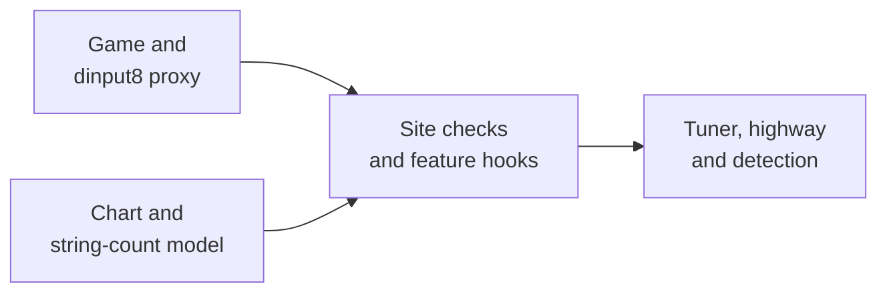

# Developer start

**How rs7string works in five minutes, and where to go next.**

[Contributing](../CONTRIBUTING.md) · **Developer start** · [Development](DEVELOPMENT.md) · [Architecture](ARCHITECTURE.md) · [RS7X spec](release/RS7X-SPEC.md) · [Agents](../AGENTS.md)

## The idea in one paragraph

Rocksmith 2014 was written for six-string guitars and four-string basses. rs7string is a `dinput8.dll` that the game
loads at startup. It finds a few hundred known places in the running game's code and redirects them into its own
code, which teaches the game about a seventh and eighth guitar string and a fifth and sixth bass string. Charts
say how many strings they need. Six-string guitar, four-string bass and stock songs retain their normal behaviour,
even though they also run through shared patched code.

## How it fits together

The proxy checks and patches the running game; chart data then tells the shared model which
instrument to build. Feature hooks use that model for gameplay.



| Piece | What it does | Read more |
|---|---|---|
| **Startup** | The DLL forwards the real `dinput8` calls to Windows. A worker thread waits until the game is unpacked in memory, checks that it is the September 2022 build, and only then patches. | [Patch mechanism](architecture/02-patch-mechanism.md) |
| **Sites** | `sites.json` lists the places the mod changes, with byte patterns and expected stock bytes. A failed core site stops the main patch batch; other feature groups can be isolated. | [Patch mechanism](architecture/02-patch-mechanism.md), [hook sites](agents/hook-sites.md) |
| **Hooks** | Each site jumps into a small piece of mod code: a mid-hook (plain C++ that sees the CPU registers) or an older assembly stub. Both are checked against the game's own code in an emulator. | [Mid-hook contract](architecture/14-mid-hook-contract-and-cold-site-conversion.md) |
| **String count** | One model says how many strings the current instrument has; every feature (highway, detection, tuner, chords, headstock) asks it instead of assuming six. | [String-count model](architecture/03-the-string-count-model.md), [eight strings](architecture/12-eight-strings.md) |
| **Charts** | An extended chart is a normal arrangement with extra `Rs7String` tuning keys and an RS7X block inside the SNG. Extended guitar charts also have a longer tuning. | [Charting guide](release/CHARTING.md), [RS7X spec](release/RS7X-SPEC.md) |
| **Settings** | `rs7string.ini` and the F9 overlay share one settings table. A bad value falls back to the safe default. | [Settings](release/SETTINGS.md), [overlay and logging](architecture/11-window-input-overlay-logging.md) |

## Your first build

You need Windows, Visual Studio Build Tools (toolset v145, Win32), PowerShell and [uv](https://docs.astral.sh/uv/).

```powershell
.\build.ps1                     # the DLL and the native unit tests
uv run pytest tools\tests -q    # site table and emulator tests
```

The build never copies anything into a game folder. Some tests need an unpacked copy of **your own** game
executable and skip without it; see [Development](DEVELOPMENT.md#build-and-test).

## Where the code lives

| Folder | What is in it |
|---|---|
| `src/features/<name>/` | One folder per feature: its hooks, logic, settings and registration. Its native tests are in `tests/<name>/`. |
| `src/model/` | The string-count model and the chart's extension block, which every feature reads. |
| `src/platform/` | Shared plumbing: patching, site resolution, mid-hooks, memory protection, log, settings. |
| `src/overlay/` | The F9 overlay. |
| `src/d3d/` | Direct3D hooks: the frame hook the overlay draws in, and texture swaps. |
| `tools/` | Site table generator, `sitecheck`, export check, emulator tests. |
| `tests/` | Native unit tests. |

The full map is in [Source layout](architecture/15-source-layout.md).

## Rules that matter

- No Ubisoft data in the repository: no keys, game files or disassembly listings. Short addresses and names are
  fine.
- A compiler warning or a new static-analysis finding fails the build.
- New hooks are C++ mid-hooks, not new assembly stubs.
- Claims about the game in developer docs are tagged **CONFIRMED** (with evidence) or **HYPOTHESIS**.

The complete list is in [CONTRIBUTING.md](../CONTRIBUTING.md) and [AGENTS.md](../AGENTS.md).

## Next steps

<div class="grid cards" markdown>

- **Build, test and debug**

    ---

    Every tool, debug setting and CI job. [Development](DEVELOPMENT.md)

- **How every part works**

    ---

    Every part in its own chapter, from patching to chord diagrams. [Architecture](ARCHITECTURE.md)

- **Known limits**

    ---

    What is open and risky before you change it. [Known limitations](architecture/13-known-limitations-and-open-risks.md)

- **Send a change**

    ---

    Branches, pull requests and checks. [Contributing](../CONTRIBUTING.md)

</div>
