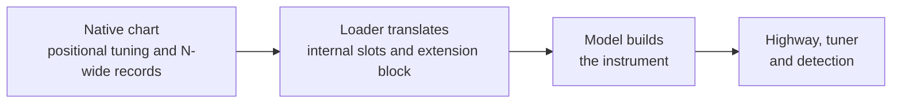

# 1. What the mod does

Part of the [RS Extended Range architecture](../ARCHITECTURE.md).

RS Extended Range is a `dinput8.dll` proxy. It patches the running game to support seven- and eight-string
guitars and five- and six-string basses. Ordinary instruments keep their normal behavior, although
they also run through the shared patched code.

## From chart to gameplay

The chart declares the extended instrument. The mod uses that information to build the instrument
and to calculate the expected notes.

For a seven-string guitar, the SNG tuning has seven entries. String index 6 is the low B. Its
expected MIDI note is `35 + tuning offset + fret`. See [String-count model](03-the-string-count-model.md)
and [Detection and scoring](06-detection-and-scoring.md) for the implementation and evidence.
