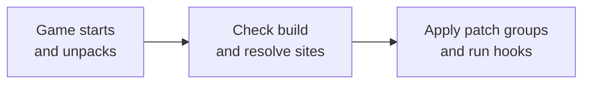

# 2. Patch mechanism

Part of the [RS Extended Range architecture](../ARCHITECTURE.md).

The proxy waits until the game has unpacked itself. It then checks the build, resolves every site and
writes the patches. A failed core site stops the main batch. Other groups can fail on their own without
stopping it. Plain PSARC loading is a separate unit.

## Startup

The proxy forwards to the system `dinput8.dll`. A worker thread waits for `d3d9.dll` to load, because by
then the exe is unpacked. The thread then checks the PE checksum, resolves every site and writes jumps into
the DLL's stubs. The DLL must not import `d3d9.dll`, or `d3d9.dll` would load before the wait.
`tools/check_exports.py` enforces this.

## Sites

Sites are listed in `sites.json`. `tools/gen_sites.py` turns them into
`src/generated/sites.generated.h`, which is not committed. Each site has:

- an id
- a byte `pattern` (with `??` wildcards) that must match exactly once in `.text`
- an `offset`
- the `expect`ed stock bytes
- a `note` with its purpose and address
- a kind:

| Kind | Meaning |
|---|---|
| `jmp` | overwrite with a jump into a stub or mid-hook |
| `jmp_atomic8` | the same, written as one 8-byte exchange |
| `call` | redirect the `E8` call at the site |
| `rel32` | rewrite a rel32 operand |
| `bytes` | in-place byte patch |
| `ref` | read the dword at the site (for example a game global) |
| `callref` | read the callee of the `E8` at the site |

Sites are resolved per feature group. A missing or mismatching site disables its own group before
anything is written (see [Coexistence and safety](#coexistence-and-safety)). Only a core site, or a
member of a unit without a fallback, stops patching altogether (`src/platform/isolate.h`).
`tools/sitecheck.py` resolves all sites again against an unpacked copy of the game image. It also checks
that each site covers whole instructions and has no inbound branch.

## Stubs

Stubs (`src/features/<name>/hooks_stubs*.cpp`) are naked functions that replay the displaced stock
instructions. They are checked against the stock code in the Unicorn emulator
(`tools/tests/test_emu*.py`).

## Mid-hooks

Mid-hooks (`src/platform/midhook.*`, CONFIRMED by unit and emulator tests) give a site a plain C++
callback `void __cdecl Callback(RsxrMid::Context&)` instead of hand-written assembly. One common
thunk (`src/platform/midhook_thunks.asm`) does the work:

1. It saves GPRs, EFLAGS and x87/SSE state, and clears DF.
2. It calls the callback.
3. It restores the saved state.
4. It returns into a relocated copy of the displaced instructions. That copy jumps back to
   `site + stolen length`.

- `ctx.esp` is the original game ESP. The callback can change registers and flags. Setting `ctx.jump`
  skips the replay. `Context::St0` / `PushSt0` edit the saved x87 stack.
- The relocator accepts common ALU/MOV/LEA/TEST, register PUSH/POP, immediates, MOVZX/MOVSX/SETcc
  and relative CALL/JMP/Jcc. It accepts one `0x66` operand-size prefix on supported forms, but not
  transfers, x87 or SETcc. It rejects other prefixes, LOOP/JCXZ, indirect transfers, unknown opcodes,
  branches into instruction interiors, internal calls and call/pop. There is no blind-copy fallback.
  Callees that inspect their return address need a hand-written hook
  ([chapter 14](14-mid-hook-contract-and-cold-site-conversion.md)).
- Modes and their cost, measured on one machine (a microbenchmark, not frame time; CONFIRMED,
  `tests/test_midhook_bench.cpp`, three runs with the guard):
  - Full: 237-245 ns per call.
  - Light (`RsxrHook::midMode = RsxrMid::Mode::Light`): 50-51 ns. It saves no floating-point state and
    is for callbacks without x87/SSE code.
  - Sse (`RsxrMid::Mode::Sse`): 55-59 ns. It saves only XMM0-7 and MXCSR and is for SSE float math
    without x87.
- Besides `jmp` sites, a mid-hook can sit on a `jmp_atomic8` site or on a `call rel32`
  ([chapter 14, "Call sites"](14-mid-hook-contract-and-cold-site-conversion.md#call-sites)).
  On a call it has three placements:
  - **Before** runs at the callee's entry. `RsxrMid::Ret` / `Return` replace the callee.
  - **After** runs after the callee returned.
  - **Wrap** (`RsxrMid::Call::Wrap`) runs the callee on copies of its arguments, between an optional
    before callback and an after callback. Both callbacks see the original arguments
    (["Wrap placement"](14-mid-hook-contract-and-cold-site-conversion.md#wrap-placement)).
- Live detach is not supported.

D2/D3 in `src/features/diag/hooks.cpp` show the registration pattern. To add a mid-hook:

1. Add a `jmp` site (5..16 bytes, whole instructions).
2. Write the callback.
3. Add its row to the feature's `registration.cpp` with the builders in `platform/hooktable.h`
   (`Rsxr_Mid("ID", &Rsxr_Mid_ID, &g_rsxr_resume_ID)`, then `.Light()` / `.Sse()`, `.After()`,
   `.Gate(kRsxrGate...)` from `model/gates.h`).
4. Add an emulator comparison.
5. Run the gates.

## Copied game functions

Some stock functions are copied byte for byte from the game image. Only their array displacements and
count bytes change, to point at the capacity-8 layouts (`tools/gen_fncopy.py`, `gen_tuner8s.py`,
`gen_publish*.py` -> `src/features/<name>/*generated.h`). Each copy is checked against the live code
at startup (FNV-1a) and against the stock function in the emulator.

Some copies call into RS Extended Range, through a call edit in place of one stock instruction or call.
The target of such a call is either a call-in entry or one of the few remaining asm helpers. A call-in
entry is a C++ callback that gets the copy's registers (`RsxrMid::CallIn`,
[chapter 14, "Call-in entries"](14-mid-hook-contract-and-cold-site-conversion.md#call-in-entries)).

## Coexistence and safety

- Each write is one locked 8-byte compare-exchange (`InterlockedCompareExchange64`,
  `src/platform/patch.cpp`) on a window inside one cache line. Each site is classified as stock, ours or
  foreign. A foreign write (from another mod) is logged, and the mod leaves that group alone.
- A recoverable failure while preparing or writing at startup disables the site's group. If that group
  has a fallback, the patch round restarts ("isolation", `src/platform/isolate.cpp`).
- A handled runtime callback fault restores the saved context and default continuation, then counts
  the fault (CONFIRMED by `tests/test_midhook_guard.cpp`, `RsxrMid_Guard` in `src/platform/midhook.cpp`).
  Full mode also restores the saved x87 state. SSE mode drops a pending `LoadSt0`. The first 20 faults
  are logged as `hook fault: callback dinput8+<offset>`. Memory writes made before the fault stay written.
  The feature stays enabled, so later hits call it again. No patch round restarts.
- The native layouts (colors, PegSet, GuitarStrings, FretGrid, pitch, next-note grid, publication,
  tuner, C-lite) form one unit with no fallback (`Rsxr_IsSevenUnit`, `src/model/groups.cpp`). If a
  member fails at startup, nothing of the main batch is written and the game stays stock, with a
  six-string guitar and a four-string bass. Plain PSARC is separate. Diagrams, chord loops, the private extras and
  diagnostics are isolated on their own.
- A loss at runtime (the deferred FretGrid write) clears only the switches that the stubs read, together
  with those of its dependents (publication, tuner, C-lite).
- Feature switches live in `rsxr.ini` (see [SETTINGS.md](../release/SETTINGS.md)).
- RSMods hooks d3d9 function bodies, not vtables, so the hooks chain in either order. RS_ASIO and RSMods
  were tested together with the mod.
