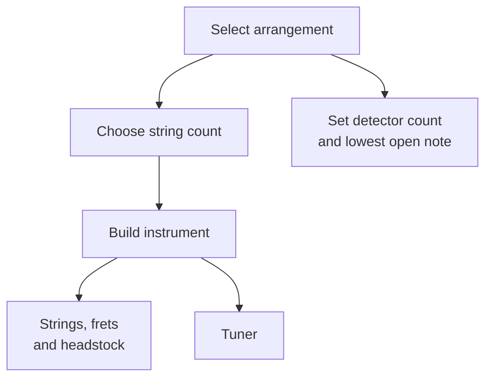

# 3. The string-count model (C-lite)

Part of the [rs7string architecture](../ARCHITECTURE.md).

The string count belongs to the **built instrument**; features do not switch it on their own.
Selecting an arrangement can rebuild the guitar or bass, and its visuals and tuner then use the same
count: 6, 7 or 8 for a guitar, 4, 5 or 6 for a bass.

## Build and song state

The code is in `src/features/clite/`. The sites (all CONFIRMED, addresses in `sites.json`):

| Site | Where | What it does |
|---|---|---|
| GKT | `0x5B6098` in `Play_Tuning_SetPlayerTargetTuning` | reads the wanted count from the manifest keys and triggers the rebuild at song selection |
| GKM | `0x595ECB` in `Rnd_Guitar_RebuildIfProfileChanged` | remembers the guitar manager and the player being loaded |
| GKC | `0x593CC0` in `Rnd_GuitarProfile_Load` `0x593B00`, guitar branch | writes the guitar count (6/7/8) |
| GKB | `0x593D33` in `Rnd_GuitarProfile_Load`, bass branch | writes the bass count (4/5/6) and one peg per string |
| GKE | `0x596341` in `Rnd_GuitarProfile_Equals` | profiles with different counts are not equal, so the game rebuilds |
| GKL | `0x77CE9F` in `GetGuitarStringCount` `0x77CE50` (Lua) | answers the built count |

Counts from the manifest `Tuning` keys: guitar 7 with `Rs7String6`, 8 with `Rs7String6` and
`Rs7String7`, else 6; bass 5 with `Rs7String4` (low B), 6 with `Rs7String4` and `Rs7String5` (high
C), else 4 (`rs7clite::Desired`, `BassDesired`).

The rebuild uses the stock "profile changed, rebuild the guitar" path, the same one a guitar <-> bass
switch uses, and takes a few milliseconds. `InstrumentInfo +0Bh` then holds the count for the
instrument's whole life, and everything it shows (extra string lines and pegs, wider fret bars,
headstock, tuner strings) follows it. Nothing is published at song setup, switched in the tuner or
restored at song end. Selecting a 6-string song, or entering Session Mode, Guitarcade, Lessons or the
technique hub, rebuilds a 7/8-string guitar to 6.

Per song (S4 `0x7DF0FC`, `Rs7Song_WidenDetector`): the detector's active count and lowest open note,
only for a 7/8-entry tuning on a guitar built with that count.

## Design decisions

- **Native layouts instead of per-feature extrapolation.** The stock arrays are widened to capacity
  8 and the stock code runs over them (GuitarStrings, PegSet, colours, FretGrid, pitch, next-note
  grid, publication ports, tuner, chord loops). C-lite needs the native tuner and the publication
  ports, and they need the others. These form one unit with no ini switch and no fallback: a member
  that fails its startup check leaves the game stock ([chapter 2](02-patch-mechanism.md)). Only the
  per-song S4 step handles a runtime loss of the ports.
- **Rebuild faults use the callback guard.** GKT is a full-mode mid-hook at `0x5B6098`
  (`src/features/clite/registration.cpp`). A handled fault restores its context and resumes the site,
  but does not undo earlier memory writes from the rebuild. The guard counts faults and logs the first 20 as
  `hook fault: callback dinput8+<offset>` (CONFIRMED by `tests/test_midhook_guard.cpp`);
  [chapter 2](02-patch-mechanism.md#coexistence-and-safety) describes the recovery limits. There is no switch
  to turn C-lite off; removing `dinput8.dll` turns the mod off.

## Local co-op

Each player's instrument is built for that player's arrangement. The wanted counts are per player
(`g_rs7_clite_desired[2]`, `g_rs7_clite_bass[2]`).

- GKT stores and rebuilds the player whose tuning is stored (song select and tuner menu); GKC/GKB
  read the count of the player GKM is loading.
- A mode entry stores player 0's tuning only, so it also rebuilds player 1's 7/8-string guitar with 6
  (`NormaliseSlot1`).
- Extended bass keeps one setup per detector (`rs7bass::Players`; S4 runs once per player).
- The chord frames follow each highway's own guitar (`OnBoxGeom`).
- The bass low-B colour swap (slot 4) is skipped when a guitar plays in the same song, because slot 4
  is the guitar's B string.

Per-player state is keyed by the object the hook sees, so each feature uses the key its hooks have:

| Key | Used by | Why |
|---|---|---|
| Detector | pitch song tables (`pitch/hooks.cpp`), extended bass setups (`bass.h` `Players`) | Song setup (S4) and the pitch readers get the detector |
| Player index 0 / 1 | C-lite counts (`clite/clite.cpp`) | GKT / GKM know the player, not the guitar yet |
| Guitar object | string7 modes, fret states (`kMaxGuitars` tables) | Render and bar hooks get the guitar |
| Song session | song end (`songend/songend.cpp`) | The end hooks get the session |
| Tuner object | tuner keys (`tuner/state.h`) | The tuner hooks get their own object |

New per-player state uses the key its hooks already have; the `rs7::ObjTable` (`model/objtable.h`) holds the
address-keyed ones. Two things stay song-wide: the extended bass string count the per-note pitch callbacks read
(`g_rs7_bass_strings`, the largest of the players; those callbacks have no detector, and only an extended bass asks
for strings 4 / 5) and the bass low-B colour (one colour slot, see above).

## Stock readers and bounds

A guitar built with 7 or 8 strings must not reach stock readers of `+0Bh` that index six-slot
arrays. A sweep found 108 byte reads of `+0Bh` in 61 functions. Verdicts (CONFIRMED statically):

- 53 functions are safe because a native copy or port runs.
- 4 alias inside the GuitarStrings object (cosmetic).
- `Rnd_Headstock_LoadStringMeshes` `0x58E090` overflowed the 0x38-byte headstock object (crash on a
  6 to 7 rebuild). Sites GKH1 `0x58E1BA` / GKH2 `0x58E36D` clamp both loop bounds to 6; the extra
  segments `string_size_7` / `_8` are handled by the asset code (`src/features/headstock/`).
- Three Session Mode harmony readers (`0x4435F0`, `0x444C30`, `Rnd_ScaleChordMarkers_Update`
  `0x445740`) index `[6][26]` arrays with `+0Bh` and overflow. This is why entering Session Mode
  rebuilds the guitar to 6.

## Lua and failure handling

Lua `GetGuitarStringCount` `0x77CE50` (site GKL) answers 7/8 for such a guitar. HYPOTHESIS: Lua
tuner/diagram code loops over it; not verified.

`GridBuild` waits up to 5 s for the FretGrid layout. A timeout completes the load but marks the neck
FAILED, and the detector then stays at six strings (logged). Known limit: selecting the same 7-string
width again does not rebuild (stock `Equals` sees equal profiles), so the FAILED mark stays until a
6-string selection.

> [!NOTE]
> Two players were covered by the 2026-10-31 release matrix ([eight strings](12-eight-strings.md#what-was-checked)).
> Not run in the game: Session Mode after a 7-string song.
