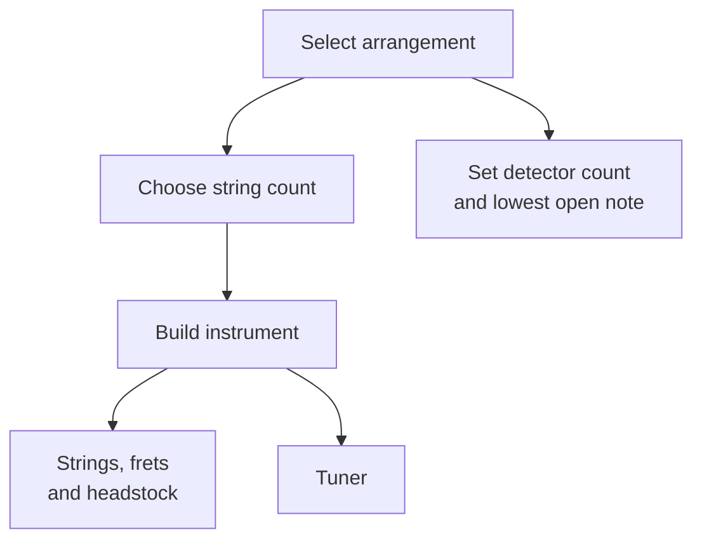

# 3. The string-count model (C-lite)

Part of the [RS Extended Range architecture](../ARCHITECTURE.md).

The string count belongs to the **built instrument**. Features do not switch it on their own.
Selecting an arrangement can rebuild the guitar or bass. Its visuals and tuner then use the same
count: 6, 7 or 8 for a guitar, and 4, 5 or 6 for a bass.

## Build and song state

The code is in `src/features/clite/`. These are its sites (all CONFIRMED, addresses in `sites.json`):

| Site | Where | What it does |
|---|---|---|
| GKT | `0x5B6098` in `Play_Tuning_SetPlayerTargetTuning` | reads the wanted count from the manifest keys and triggers the rebuild at song selection |
| GKM | `0x595ECB` in `Rnd_Guitar_RebuildIfProfileChanged` | remembers the guitar manager and the player being loaded |
| GKC | `0x593CC0` in `Rnd_GuitarProfile_Load` `0x593B00`, guitar branch | writes the guitar count (6/7/8) |
| GKB | `0x593D33` in `Rnd_GuitarProfile_Load`, bass branch | writes the bass count (4/5/6) and one peg per string |
| GKE | `0x596341` in `Rnd_GuitarProfile_Equals` | profiles with different counts are not equal, so the game rebuilds |
| GKL | `0x77CE9F` in `GetGuitarStringCount` `0x77CE50` (Lua) | answers the built count |

The count comes from the manifest `Tuning` keys (`rsxrclite::Desired`, `BassDesired`):

- Guitar: 7 with `RsxrString6`, 8 with `RsxrString6` and `RsxrString7`, otherwise 6.
- Bass: 5 with `RsxrString4` (low B), 6 with `RsxrString4` and `RsxrString5` (high C), otherwise 4.

The rebuild uses the stock "profile changed, rebuild the guitar" path. A guitar <-> bass switch uses
the same path. The rebuild takes a few milliseconds. After it, `InstrumentInfo +0Bh` holds the count for
the instrument's whole life. The extra string lines and pegs, the wider fret bars, the headstock and the
tuner strings all follow that count. Nothing is published at song setup, switched in the
tuner or restored at song end. Selecting a 6-string song rebuilds a 7/8-string guitar to 6. So does
entering Session Mode, Guitarcade, Lessons or the technique hub.

Per song, S4 (`0x7DF0FC`, `RsxrSong_WidenDetector`) sets the detector's active count and lowest open
note. It does this only for a 7/8-entry tuning on a guitar built with that count.

## Design decisions

- **Native layouts instead of per-feature extrapolation.** The stock arrays are widened to capacity
  8, and the stock code runs over them (GuitarStrings, PegSet, colors, FretGrid, pitch, next-note
  grid, publication ports, tuner, chord loops). C-lite needs the native tuner and the publication
  ports, and those need the others. Together they form one unit with no ini switch and no fallback. If a
  member fails its startup check, the game stays stock ([chapter 2](02-patch-mechanism.md)). Only the
  per-song S4 step handles a loss of the ports at runtime.
- **Rebuild faults use the callback guard.** GKT is a full-mode mid-hook at `0x5B6098`
  (`src/features/clite/registration.cpp`). A handled fault restores its context and resumes the site,
  but does not undo earlier memory writes from the rebuild. The guard counts faults and logs the first 20 as
  `hook fault: callback dinput8+<offset>` (CONFIRMED by `tests/test_midhook_guard.cpp`).
  [Chapter 2](02-patch-mechanism.md#coexistence-and-safety) describes the recovery limits. There is no switch
  to turn C-lite off. To turn the mod off, remove `dinput8.dll`.

## Local co-op

Each player's instrument is built for that player's arrangement. The wanted counts are per player
(`g_rsxr_clite_desired[2]`, `g_rsxr_clite_bass[2]`).

- GKT stores and rebuilds the player whose tuning is stored (song select and tuner menu). GKC/GKB
  read the count of the player that GKM is loading.
- Entering a mode stores only player 0's tuning. So it also rebuilds player 1's 7/8-string guitar
  with 6 (`NormaliseSlot1`).
- Extended bass keeps one setup per detector (`rsxrbass::Players`; S4 runs once per player).
- The chord frames follow each highway's own guitar (`OnBoxGeom`).
- The bass low-B color swap (slot 4) is skipped when a guitar plays in the same song, because slot 4
  is the guitar's B string.

Per-player state is keyed by the object the hook sees. Each feature therefore uses the key that its
hooks have:

| Key | Used by | Why |
|---|---|---|
| Detector | pitch song tables (`pitch/hooks.cpp`), extended bass setups (`bass.h` `Players`) | Song setup (S4) and the pitch readers get the detector |
| Player index 0 / 1 | C-lite counts (`clite/clite.cpp`) | GKT / GKM know the player, not the guitar yet |
| Guitar object | string7 modes, fret states (`kMaxGuitars` tables) | Render and bar hooks get the guitar |
| Song session | song end (`songend/songend.cpp`) | The end hooks get the session |
| Tuner object | tuner keys (`tuner/state.h`) | The tuner hooks get their own object |

New per-player state uses the key its hooks already have. The `rsxr::ObjTable` (`model/objtable.h`) holds the
address-keyed ones. Two things stay song-wide:

- The extended bass string count that the per-note pitch callbacks read (`g_rsxr_bass_strings`, the largest of
  the players). Those callbacks have no detector, and only an extended bass asks for strings 4 / 5.
- The bass low-B color (one color slot, see above).

## Stock readers and bounds

A guitar built with 7 or 8 strings must not reach stock readers of `+0Bh` that index six-slot
arrays. A sweep found 108 byte reads of `+0Bh` in 61 functions. The verdicts (CONFIRMED statically):

- 53 functions are safe because a native copy or port runs.
- 4 alias inside the GuitarStrings object (cosmetic).
- `Rnd_Headstock_LoadStringMeshes` `0x58E090` overflowed the 0x38-byte headstock object (crash on a
  6 to 7 rebuild). Sites GKH1 `0x58E1BA` / GKH2 `0x58E36D` clamp both loop bounds to 6. The asset code
  (`src/features/headstock/`) handles the extra segments `string_size_7` / `_8`.
- Three Session Mode harmony readers (`0x4435F0`, `0x444C30`, `Rnd_ScaleChordMarkers_Update`
  `0x445740`) index `[6][26]` arrays with `+0Bh` and overflow. This is why entering Session Mode
  rebuilds the guitar to 6.

## Lua and failure handling

Lua `GetGuitarStringCount` `0x77CE50` (site GKL) answers 7/8 for such a guitar. HYPOTHESIS: Lua
tuner/diagram code loops over this count. This is not verified.

`GridBuild` waits up to 5 s for the FretGrid layout. On a timeout, the load completes but the neck is
marked FAILED. The detector then stays at six strings, and this is logged. Known limit: selecting the
same 7-string width again does not rebuild, because stock `Equals` sees equal profiles. The FAILED mark
therefore stays until a 6-string selection.

> [!NOTE]
> Two players were covered by the 2026-10-31 release matrix ([eight strings](12-eight-strings.md#what-was-checked)).
> Not yet run in the game: Session Mode after a 7-string song.
