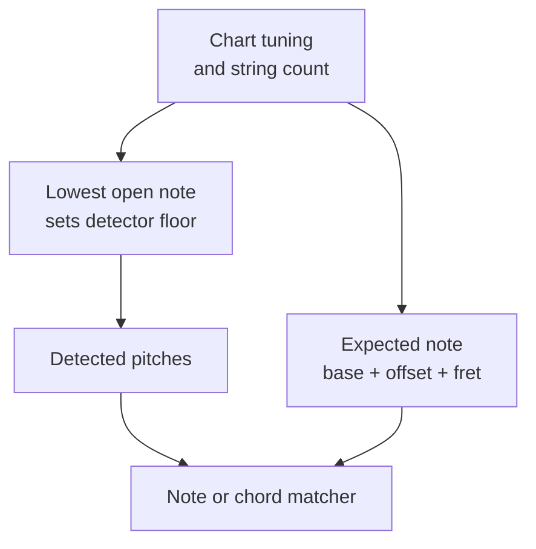

# 6. Detection and scoring

Part of the [rs7string architecture](../ARCHITECTURE.md).

The detector needs the **expected pitch** of each note and a search floor low enough to hear the
instrument's lowest open string. A 7/8-string guitar uses the native eight-slot pitch storage
([chapter 4](04-native-capacity-8-layouts.md)); a 5/6-string bass keeps its extra strings in the
stock six slots with their own bases.

## Song setup and matching

- S4 `0x7DF0FC` reads the SNG tuning at song setup; S3 at the exit of `Play_Detector_SetTuning`
  `0x4E263B` sets the lowest open MIDI (`35 + t6` for a 7-string guitar). S1 `0x873F98` and PE0
  `0x873E90` give the expected pitch (native storage: [chapter 4](04-native-capacity-8-layouts.md)).
- The single-note matcher is lenient by stock design (a near-pitch fallback `0.5 +
  Play_Matcher_PitchTolerance`, history-indexed read at `0x4E5A61`). In the automated test runs,
  string-6 notes never scored on a wrong pitch; stock strings can.

## Low tunings

For any instrument, `rs7p::Floor` and `Rs7Pitch_DetFloor` make the detector's raw floor follow the song's
  lowest open string, so a low tuning needs no "low tuning fix" and no A220 reference trick.

CONFIRMED readers of the floor `+11F4h` (reset `0x4DBF73` writes 24 = C1): `0x4DF2B0` evaluates every MIDI from the floor to 100 per frame
  (`0x4DF4D0`: the strength at lag = rate `+DCCh` / frequency, cubic-interpolated from a lag buffer whose length
  `+DD4h` it clamps to length - 4), `0x4DF613` picks peaks from the floor up, `0x4E01B7` drops candidates below it.

After every writer of the lowest open MIDI `+11F8h` (PR0, PT1, S3, S4 after the C-lite widening, the tuner's low
  range) the floor becomes one below the lowest open string when that is below the reset's floor, else the reset's
  floor again. PR0 records the floor the reset wrote per detector, so another mod's patched floor (RSMods' low tuning
  fix writes 18 at `0x4DBF79`) is never raised.

Lower limit 18: in game (log) the rate is 48000 and the buffer 2048,
  so the clamp is at 23.5 Hz = MIDI 18.3 and G0 (19) is the lowest open string whose lag fits.

CONFIRMED in game with
  automated test runs (2026-10-30, low-tuning test charts): 5-string bass in A standard
  (A0) and drop G (G0) and 8-string guitar with the 8th string at B0: every open, fretted, bend, slide, vibrato,
  tremolo and pinch-harmonic note on the low string scored (only harmonics missed, as on the stock control string),
  bass chords 20/20 in both tunings; the old fixed floor of 22 missed the open A0 and the drop A chords with it (14/20).
  Not covered: the 8th string's bend at B0 (0/1) and two low open-string chords (B0 + F#1 + E2) still miss; they are
  above the floor. Stock songs keep 24 (C standard bass included: the floor drops only below C1).

Low chords (`src/features/nslot/match.cpp`): the stock chord matcher `0x4E7B30` hears a chord's lowest note on its
  fundamental only, but below E1 these strings sound mostly at their octave, so low B chords missed. A chord with 2-3
  distinct targets whose lowest is below MIDI 28 (`rs7match::LowChord`) runs through the port `MatchN` with
  `lowOctave` set: its special row also accepts that note + 12. Every other chord of up to six targets still runs the
  stock body. CONFIRMED in game (2026-11-01, DotCharter suite): `b5_chords` 10/16 -> 16/16, `b6_chords` 14/16 ->
  15/16 (the miss left is a full six-note chord); emulator test `test_md1_low_chord_matches_the_lowest_note_on_its_octave`.

## Extended bass

In `src/features/bass/`, an RS7X block with
  STRS instrument 1 marks a 5/6-string bass arrangement (S4 finds the song as tuning vector - 110h, CONFIRMED
  `0x7DF0CC`). Strings 4 (B0, 23) / 5 (C3, 48) live in the stock six slots. The bass is built natively with 5 / 6
  strings, like a 7/8-string guitar (C-lite): the manifest's `Rs7String4` / `Rs7String5` Tuning keys give the count
  GKT stores, GKB (CONFIRMED `0x593D33`, bass branch of `Rnd_GuitarProfile_Load`) writes it and one peg per string
  into the bass profile.

| Extra bass string | Index | Open MIDI | Manifest key |
|---|---:|---:|---|
| Low B | 4 | 23 | `Rs7String4` |
| High C | 5 | 48 | `Rs7String5` |

### Adapting the stock four-string build

Several parts of the stock build assume four bass strings. The mod extends their inputs and uses
locally built headstocks for the additional pegs.

| Part | Extended-bass change |
|---|---|
| Attach points and counts | Extrapolate positions for the extra strings and load the active count. |
| Headstock and pegs | Select a five- or six-peg model; guard missing peg locators. |
| Tuner and frets | Add the low B / high C pitches and extend the fret bars. |
| Detection | Set the extra pitches and lowest-open floor; hold low-B bend readings for the rest of the note. |

<b>Implementation details and evidence</b>

Parts of the stock build that need adjustment:

  - attach points (`stringattachpoints` has 4 bass rows): `Rs7Gs_AttachExt` extrapolates string 4 from rows 0/1 and
    string 5 from rows 3/2 (`BassAttachRows`, `StockAttachCount`);
  - string load counts: loaded = active = the build count (`RefreshCounts`);
  - **Headstock models:** the GKH loop stays at the stock bass model's four `string_size` nodes. The frame merges
    `rs7_bass6[_lh].nif` as `rs7_alt` and `rs7_bass5[_lh].nif` as `rs7_alt5`. The in-line models also work on the
    2+2 `guitar_bass/` frame, as the seven-string in-line model does on a 3+3 guitar. Textures are registered
    like the guitar model's. The frame is cached at startup before the song sets the count, so both models are
    merged and the head shows the model for the built bass.
  - **Headstock check:** CONFIRMED in game 2026-10-31: a right-handed player-2 five-string bass on a 2+2 frame
    had five pegs and letters, a low-B precision tuner and a playable song.
  - **Peg safety:** every bass peg sits on a frame locator, not a PegSet. `Locator_Peg_6` seats slot 5; without it,
    the tuner's letters crash on the empty slot (CONFIRMED `0x5B1AA0`). PSN3 `0x5B09D2` skips an empty slot and
    precision-widget copy TS8FLA `0x5B4DE0` takes its no-entity path at both slot lookups (CONFIRMED crash:
    low B selected on a 2+2 bass in the multiplayer tuner). LT0 `0x5B1AA0` uses the nearest seated record
    (`rs7head::LetterSeat`), so a frame without our model shows letters on shared pegs instead of crashing.
  - **Headstock packages:** `rs7string_headstock_bass[_lh].bin` contains the `Bass` / `BassLh` kits. The model
    is self-built from the player's bass templates the first time a bass frame finds no model.
  - headstock string segments: `Rnd_Headstock_LoadStringMeshes` (`0x58E090`) loads `string_size_<n>` per stock slot;
    our bass models name them by string (E 10, A 9, D 8, G 7, low B 11, high C 6, `BassSegName`), so `FindSegments`
    binds slots 4/5 by those names, sets their loaded flag (head `+18h`) and copies slot 0's draw layer
    (`LayerBass`), else the per-frame colour copy (`0x58E4F0`) skips them and they draw black;
  - tuner: the bass open MIDI table (`0x1199CA4`, `28 33 38 43 0 0`, ref site X_TBASS, read by `0x5AF200`,
    `0x5AE91B`, `0x5B2AC7`) gets `[4]/[5] = 23 / 48` from GKB, so the low B / high C pegs read B / C and their
    tolerance is measured from the right note. The tuning name follows the 7-string rules on the low B
    (`NameBass`: BEADG / BEADGC = "B Standard"), marked `5Str` / `6Str` (`SuffixN`);
  - frets and the floor: `ExtraLanes` and `NativeFrame` treat a 5/6-string bass as extended; on a 6-string bass the
    fret bars also reach one spacing beyond the G for the high C (`Compute` far / farLanes, `StockFar`, `FarLanes`).

PE0 / PC1-PC4 give bases 23 / 48, PT1 / PR0 / S4 fix the bound detector's open MIDI 4/5 and lowest open MIDI; the
  raw floor follows it (Low tunings above: B0 -> 22, drop A -> 20). The low B's main-string
  bend follows the tracked pitch (`0x4EA090`, read only at `0x7E3F7D` in `Rnd_Note_UpdateInProgress`): at 41-46 Hz
  the tracker drops out (-1) or falls back to the unbent note for single frames, and every such read released the bend
  at full speed, so the string barely moved (CONFIRMED by polling the peaks, detector +1284h, +28h / +3Ch). PBH (After
  placement) holds the note's last good reading over every read without a pitch for the rest of the note, and over
  readings more than 0.75 semitones lower until they have lasted 150 ms (a real release; `rs7bass::HoldBend`), only for
  string 4 on the bound detector. The hold has no time cap: a real bass's decaying low B loses the pitch for longer
  than 150 ms, and a capped hold let the bend snap back after about a second (owner report). PBH logs one line per bent low B
  note (reads without a pitch, longest gap, low reads held; first 40). Not covered yet: inverse
  pitch (I1 / `0x8750C0`), bass peg colours, a tuner wrong-instrument
  threshold for B0.

## String spacing

In `src/features/spacing/`, `[neck] spacing_bass5/6` and `spacing_guitar7/8` control spacing; 0 keeps the stock value. Every
  string position comes from `Rnd_GetStringAttachPoint` `0x594530` (CONFIRMED callers: `Rnd_GetStringCellPoints`
  `0x594DC8` -> FretGrid cells and gems, `0x594F36` -> fret spans, `Rnd_GuitarStrings_Load` `0x59A5E9` -> string
  meshes). PUBGA (its entry) and the X_ATTACH call-in answer with `Rs7Gs_AttachSpaced`: the stock point scaled by
  k = setting / |row 0 - row 1| about the centre of the stock rows (z 0 for guitar and bass, CONFIRMED in the
  `spacing:` log lines); its own stock queries re-enter PUBGA on the same thread and get the stock answer. Lanes,
  gems, strings and the floor follow; F1 measures d from the string objects, but the stock bar mesh keeps its width,
  so its midpoint and half length are scaled by k first (`ScaleBarMid`) and k is folded into the bar scale: the wires
  keep the stock margin (times k) beyond the outer strings (checked in game 2026-10-29: bass 6 at 1.608, bass 5 at
  2.01, guitar 7 at 1.34; inlays stay inside the narrowed neck). The headstock's string segments are static model geometry at
  the stock pitch, so `Rs7Head_Width` (features/headstock/hooks_width.cpp) scales the frame root's rotation along the
  string axis by the recorded k every N5 frame and re-places the pegs on their moved locators: the segments meet the
  neck strings at the nut and the headstock gets narrower.

## Slide scoring

HYPOTHESIS (stock behaviour, not traced): pitched slides are credited when the glide nears the
target, unpitched slides at the onset. Whether this holds on the extra strings is an open check.
