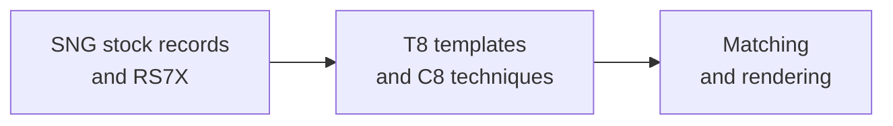

# 7. Chords on the extra strings (native N-slot)

Part of the [rs7string architecture](../ARCHITECTURE.md).

`src/features/nslot/` (records, matcher port, tracker aggregation, the RS7X store and their stubs); the chord frame span (B1/B2), the reader
for old packages (the 7th string's chord column in byte 31 of the template name) and the chord loops (the CL*
hook sites, the game's per-string chord loops widened to 8 strings) are `src/features/chords/`. The game's own chord
code runs over N-slot data for every song (6-string and bass songs get the same records with slots
6/7 empty).

## Data flow

The RS7X extension supplies the extra string data. At load time the mod combines it with the stock
records; the matcher and rendering paths then read the expanded records.

## Expanded records

At song load each chord template becomes a T8 record (stock `0x48` bytes plus
  `frets[8]`, `fingers[8]`, `midi[8]`) and each ChordNotes record a C8 record (stock `0x948` bytes
  plus `mask[8]`, `slideTo[8]`, `slideUnpitchTo[8]`, `vibrato[8]`, `bends[8]`) in relocated per-song
  arrays (XB1 `0x55922C` at load, PP1 `0x569137` after `SNG_Song_PostProcess`, SF1 `0x558686` frees).
  The stock stride sites (`begin + id*48h` / `948h`: TP1-TP12, CP1/CP2) hand out the superset
  records. Slots 6/7 come from the RS7X block; packages without it fill slot 6 from the template's
  old name byte.

CONFIRMED by `test_nslot_rejected_reload_unpublishes_arrays_and_allows_retry`: allocation failures, rejected
vectors and registry exhaustion leave the redirects using immutable, allocation-free empty T8/C8 records.
Their stock prefixes and widened arrays contain no chord notes or techniques, including unused strings 6/7.
This keeps retained render pointers valid and all widened reads in bounds, but omits chord contents for a failed
song; single notes continue. It does not preserve the song's six-string chords. Rejecting the song would require
an established game-side failure path, which these loader hooks do not provide. A later successful rebuild
restores normal chord records.

CONFIRMED by `test_tp13_resolves_registered_t8_and_preserves_stride_registers`: the diagram lookup TP13
(`0x7578BC`) keeps the stock pointer when no registered T8 matches. DGS validates registry membership before
reading widened fields; `test_loaded_serializer_tail_real_output` checks that a past-count stock pointer emits
no extra-string keys. Gameplay redirects retain the empty widened fallback described above.

## Detection and scoring

`Play_Matcher_DetectChord` `0x4E7B30` (MD1) takes int32 targets[8]. Up to six targets run the
  stock body bit for bit, except chords with 2-3 distinct targets whose lowest is below MIDI 28.
  These low chords use the port with [octave acceptance](06-detection-and-scoring.md#low-tunings).
  Seven or eight targets use the port too (`rs7match`, the game's sort and subharmonic table).
  CONFIRMED by `test_md1_low_chord_matches_the_lowest_note_on_its_octave`.
  Chord requests (`0x7B8820`), the Lua binding, mistake analysis, the whole-chord tracker and
  the eval wrappers all pass int32[8]; strings 6/7 live in the template copy's unread name area
  (BT1/CS1). Sustained/technique chords get child evals for string 6 (AG1-AG3).
  `[chords] wide_misses` (default 2): 7/8-note chords may miss up to that many notes on any string;
  5/6-note chords one, 2-4-note chords none (stock). With 2, a 7-note chord passes without its low B
  by design.

## Rendering

Rendering uses the game's own chord code over the N-slot arrays (byte patches NR*, NS*, CT*, SH*,
  HS*, NN*, NK*, NM*, FG*): gems on the 7th lane, the open-string bar for an open string 6, tails,
  slides, bends, vibrato, fret labels, finger numbers, next-note neck targets (NG9, native grid), section
  string mask, the double-stop variant (one stock string plus string 6), and chord pluck PL1 `0x7E2EFE`.

## Regression record

Automated test runs (lead 40 ms): RS7 Test 36/36, runs across 7 strings 55/55,
  techniques A 24/24, two-note chords 25/25, three-note chords 15/21, full 7-note chords
  16/16 with `wide_misses=2`; 6-string controls unchanged. Techniques on string 6 render in the 7th
  lane; their detection (bend target, slide end) is lightly tested.

## RS7X extension block

Parser: `src/model/extblock.*`; per-song store and site XB1: `src/features/nslot/`. The byte format
is in the [RS7X specification](../release/RS7X-SPEC.md).
Strings beyond the six stock slots live in a block appended to the SNG body after MetaData, inside the
zlib stream. The stock loader never reads it (CONFIRMED: `SNG_Song_Load` `0x558BD0` only checks the
inflated size against the container's size field and returns after MetaData without comparing the
stream position). XB1 hands the stream to `Rs7Ext_OnSngLoaded`, which validates it against the loaded
song and keeps it per song; the N-slot records are built from it. An open extended string gets a
ChordNotes record with its OPEN bit like an open stock string; a chord of one stock string plus one
extended string is a double stop.
