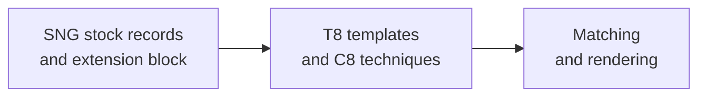

# 7. Chords on the extra strings (native N-slot)

Part of the [RS Extended Range architecture](../ARCHITECTURE.md).

The chord code for the extra strings lives in two places:

- `src/features/nslot/` holds the records, the matcher port, the tracker aggregation, the extension block
  store and their stubs.
- `src/features/chords/` holds the chord frame span (B1/B2) and the chord loops. The chord loops are the CL*
  hook sites, where the game's per-string chord loops are widened to 8 strings.

The game's own chord code runs over N-slot data for every song. Six-string and bass songs get the same
records, with slots 6/7 empty.

## Data flow

The extension block supplies the data for the extra strings. At load time the mod combines it with the stock
records. The matcher and the rendering paths then read the expanded records.

## Expanded records

At song load, the mod expands two kinds of records into relocated per-song arrays.

- Each chord template becomes a T8 record: the stock `0x48` bytes plus `frets[8]`, `fingers[8]` and
  `midi[8]`.
- Each ChordNotes record becomes a C8 record: the stock `0x948` bytes plus `mask[8]`, `slideTo[8]`,
  `slideUnpitchTo[8]`, `vibrato[8]` and `bends[8]`.

XB1 `0x55922C` builds the arrays at load, PP1 `0x569137` runs after `SNG_Song_PostProcess`, and SF1
`0x558686` frees them. The stock stride sites (`begin + id*48h` / `948h`: TP1-TP12, CP1/CP2) hand out the
superset records. CONFIRMED (source: `src/features/nslot/hooks.cpp`, `ExtCols`): slots 6/7 come from the
extension block. Without a valid block, the extra chord columns are empty.

CONFIRMED by `test_nslot_rejected_reload_unpublishes_arrays_and_allows_retry`: when allocation fails, a
vector is rejected or the registry is full, the redirects use immutable, allocation-free empty T8/C8 records.
Their stock prefixes and widened arrays contain no chord notes or techniques, including on the unused strings
6/7. This keeps retained render pointers valid and keeps every widened read in bounds. The cost is that a
failed song loses its chord contents, while single notes continue. The song's six-string chords are not
preserved either. Rejecting the song instead would need an established game-side failure path, and these
loader hooks do not provide one. A later successful rebuild restores normal chord records.

CONFIRMED by `test_tp13_resolves_registered_t8_and_preserves_stride_registers`: the diagram lookup TP13
(`0x7578BC`) keeps the stock pointer when no registered T8 matches. DGS checks that a record is in the
registry before it reads widened fields. `test_loaded_serializer_tail_real_output` checks that a stock pointer
past the count emits no extra-string keys. The gameplay redirects keep the empty widened fallback described
above.

## Detection and scoring

`Play_Matcher_DetectChord` `0x4E7B30` (MD1) takes int32 targets[8]. Which code runs depends on the chord.

- Up to six targets run the stock body bit for bit. The exception is a chord with 2-3 distinct targets whose
  lowest target is below MIDI 28. These low chords use the port with
  [octave acceptance](06-detection-and-scoring.md#low-tunings).
- Seven or eight targets also use the port (`rsxrmatch`, with the game's sort and subharmonic table).

CONFIRMED by `test_md1_low_chord_matches_the_lowest_note_on_its_octave`.

Chord requests (`0x7B8820`), the Lua binding, mistake analysis, the whole-chord tracker and the eval wrappers
all pass int32[8]. Strings 6/7 live in the unread name area of the template copy (BT1/CS1). Sustained and
technique chords get child evals for string 6 (AG1-AG3).

`[chords] wide_misses` (default 2) sets how many notes a wide chord may miss, on any string.

- 7/8-note chords may miss up to `wide_misses` notes.
- 5/6-note chords may miss one note.
- 2-4-note chords may miss none (stock behavior).

With the default of 2, a 7-note chord passes without its low B. This is by design.

## Rendering

Rendering uses the game's own chord code over the N-slot arrays, through byte patches NR*, NS*, CT*, SH*,
HS*, NN*, NK*, NM* and FG*. It covers these parts.

- gems on the 7th lane, and the open-string bar for an open string 6
- tails, slides, bends and vibrato
- fret labels and finger numbers
- next-note neck targets (NG9, native grid)
- the section string mask
- the double-stop variant (one stock string plus string 6)
- chord pluck PL1 `0x7E2EFE`

## Regression record

These are the results of the automated test runs (lead 40 ms).

| Run | Result |
|---|---|
| RS7 Test | 36/36 |
| Runs across 7 strings | 55/55 |
| Techniques A | 24/24 |
| Two-note chords | 25/25 |
| Three-note chords | 15/21 |
| Full 7-note chords, with `wide_misses=2` | 16/16 |

The 6-string controls are unchanged. Techniques on string 6 render in the 7th lane. Their detection (bend
target, slide end) has had only light testing.

## Extension block

The parser is in `src/model/extblock.*`. The per-song store and site XB1 are in `src/features/nslot/`. The
byte format is in the [extension block specification](extension-block.md).

After native conversion, the strings beyond the six stock slots live in the internal loader buffer after
MetaData. The native chart on disk stores every string directly in its N-wide records. The stock loader never
reads this buffer. CONFIRMED: `SNG_Song_Load` `0x558BD0` only checks the inflated size against the
container's size field, and returns after MetaData without comparing the stream position.

XB1 hands the stream to `RsxrExt_OnSngLoaded`. That function validates the stream against the loaded song and
keeps it per song, and the N-slot records are built from it. An open extended string gets a ChordNotes record
with its OPEN bit set, like an open stock string. A chord of one stock string plus one extended string is a
double stop.
