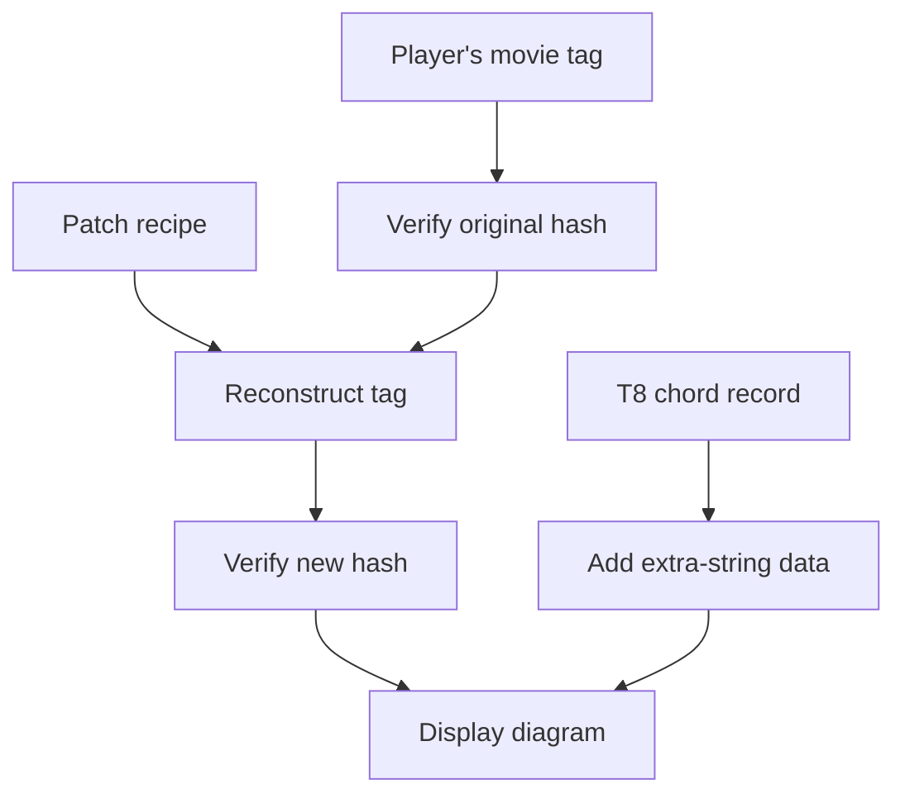

# 9. Chord diagrams (`[chords] diagrams7`)

Part of the [RS Extended Range architecture](../ARCHITECTURE.md).

Source: `src/features/diagrams/` (public interface `diagrams.h`).

The chord book, the song panel and the lesson scene draw chord diagrams from Scaleform movies
(`gfxassets/libs/commonlib.gfx`, `gfxassets/views/contentpanel.gfx`, `gfxassets/views/ge_game.gfx`).
Seven- and eight-row diagrams need a changed ActionScript class and extra data keys. The class is in the
DoInitAction tag (type 59, class sprites 1103 / 28 / 26). Only guitar chords get extra rows.

## How the diagram is built

The mod adds the extra-string data and rebuilds the movie tag in memory. If the original tag or the
rebuilt tag fails its hash check, the game keeps the original movie.

## Data delivery

- DGM `0x757698` (tail of `0x757030`) and DGS `0x7580DF` (tail of `0x757960`) run after the stock
  serializers. From the native T8 record they add `LowBFret/LowB_Finger/LowB_Color` (string 7) and
  `LowFsFret/LowFs_Finger/LowFs_Color` (string 8). The colors are `0x808080` and a provisional
  `0x00FFFF`. They also recompute the fret window over all N strings (`src/features/diagrams/diagrams.cpp`).
- TP13 `0x7578BC` routes the loaded-song template lookup through `RsxrNs_FindTplRecord`. If the lookup
  finds nothing, the stock pointer stays.
- DGB `0x55A02C` binds the UUID-selected attributes of PostProcess to the exact SNG song.
- Six-string and bass shapes get no extra keys.
- Generic database chords, catalog songs whose SNG is not loaded, a missing extension block or missing
  CHDT blocks, and mismatched six-column projections are not covered. They get the stock output.

## Movie swap

The mod wraps the Scaleform `FileOpener::OpenFile` slot at run time (data word `0x121F2D0`, vtable
`0x121F2C4` slot 3 = `0xC30330`). For a target URL the hook does the following:

1. Take the returned wrapper (`W+8` = NiFile adapter, adapter `+0x18` = IFile).
2. Check the SHA-256 of the user's original tag.
3. Rebuild the tag from the recipe.
4. Check the SHA-256 of the result.
5. Install an in-memory IFile.

On any failure the hook returns the wrapper untouched and logs `diagrams: refused ...`. Compressed
(CFX/CWS) movies are refused.

## Recipes

There is one recipe per movie (`data/chord-diagrams/*.rsxrda`, generated by `tools/diagram_patch.py`).
A recipe holds only COPY operations (offset, length), literals that do not occur in the original tag,
lengths and hashes. It contains no Ubisoft bytecode. Each recipe fits one movie build. `tools/gfxpatch`
produces the edited ActionScript class offline. It needs the user's movies and FFDec.

## Known limits

The hand-illustration fields still use the stock five-finger summaries. The eighth row is emitted (the
`LowFs` key, `src/features/diagrams/diagrams.cpp`) and drawn by the recipe movies. HYPOTHESIS: its in-game
look has not been checked on its own.
