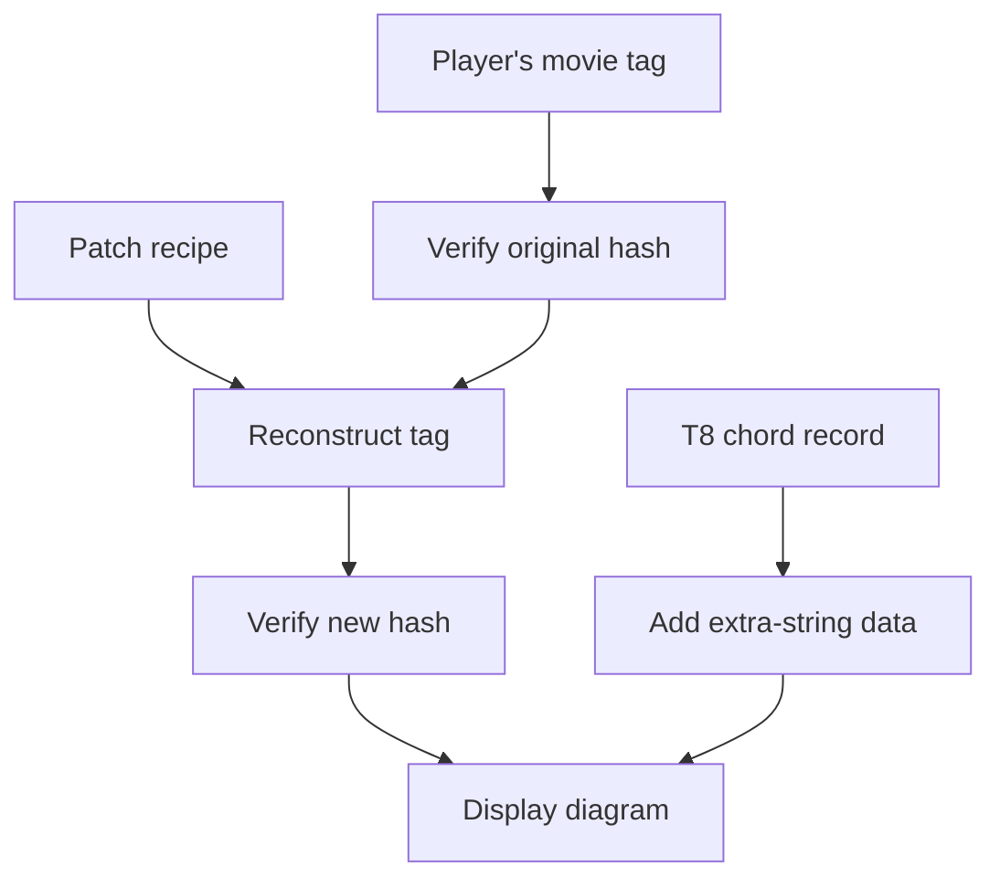

# 9. Chord diagrams (`[chords] diagrams7`)

Part of the [rs7string architecture](../ARCHITECTURE.md).

Source: `src/features/diagrams/` (public interface `diagrams.h`).

The chord book, song panel and lesson scene draw chord diagrams from Scaleform movies
(`gfxassets/libs/commonlib.gfx`, `gfxassets/views/contentpanel.gfx`, `gfxassets/views/ge_game.gfx`).
Seven- and eight-row diagrams need a changed ActionScript class (DoInitAction tag, type 59, class
sprites 1103 / 28 / 26) and extra data keys. Only guitar chords get extra rows.

## How the diagram is built

The mod adds the extra-string data and rebuilds the movie tag in memory. If the original or the
rebuilt tag fails its hash check, the game keeps the original movie.

## Data delivery

- DGM `0x757698` (tail of `0x757030`) and DGS `0x7580DF` (tail of `0x757960`) run after the stock
  serializers. From the native T8 record they add `LowBFret/LowB_Finger/LowB_Color` (string 7) and
  `LowFsFret/LowFs_Finger/LowFs_Color` (string 8), with colours `0x808080` and a provisional
  `0x00FFFF`, and recompute the fret window over all N strings (`src/features/diagrams/diagrams.cpp`).
- TP13 `0x7578BC` routes the loaded-song template lookup through `Rs7Ns_FindTplRecord`; a lookup miss keeps the stock pointer.
- DGB `0x55A02C` binds PostProcess's UUID-selected attributes to the exact SNG song.
- Six-string and bass shapes get no extra keys.
- Not covered (stock output): generic database chords, catalogue songs whose SNG is not loaded,
  missing RS7X/CHDT blocks, mismatched six-column projections.

## Movie swap

The Scaleform `FileOpener::OpenFile` slot (data word `0x121F2D0`, vtable `0x121F2C4` slot 3 =
`0xC30330`) is wrapped at run time. For a target URL the hook takes the returned wrapper (`W+8` =
NiFile adapter, adapter `+0x18` = IFile), checks the SHA-256 of the user's original tag, rebuilds the
tag from the recipe, checks the result's SHA-256 and installs an in-memory IFile. Any failure returns
the wrapper untouched and logs `diagrams: refused ...`. Compressed (CFX/CWS) movies are refused.

## Recipes

Recipes (`data/chord-diagrams/*.rs7da`, one per movie, generator `tools/diagram_patch.py`) hold
only COPY operations (offset, length), literals that do not occur in the original tag, lengths and
hashes; no Ubisoft bytecode. Each recipe fits one movie build. `tools/gfxpatch` produces the edited
ActionScript class offline (needs the user's movies and FFDec).

## Known limits

Hand-illustration fields still use the stock five-finger summaries. The eighth row is emitted (the `LowFs` key,
`src/features/diagrams/diagrams.cpp`) and drawn by the recipe movies; HYPOTHESIS: its in-game look has not been
checked on its own.
