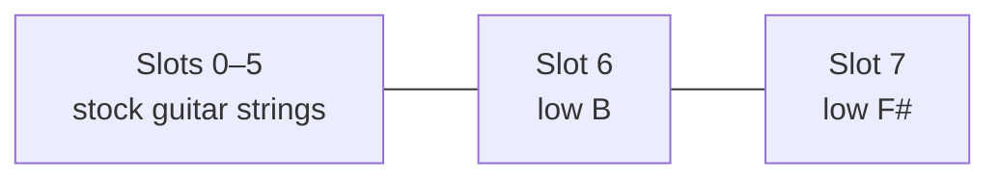

# 12. Eight strings

Part of the [rs7string architecture](../ARCHITECTURE.md).

Eight-string guitar support is always on (a leftover `[neck] eight` key is ignored and logged). The native
layouts, tuner, tuning names and chord data all have room for eight strings.

## How the slots fit together

The mod keeps the game's six string indices and adds two. This is **storage order**, not pitch order.

| Area | What changes for string 7 |
|---|---|
| Records | Eight-slot chord and note records replace the seven-bound versions. Slots 6 and 7 remain empty for stock six-string songs. |
| Tuner and names | The native tuner and eight-string name families (such as `F# Standard`) include it; names can carry the `8Str` mark. See [Tuner and tuning names](08-tuner-and-tuning-names.md). |
| Highway | Note lanes, section masks, bends and the native string receive an eighth slot. Chord frames are scaled from the lane positions instead (see [Chord frame](#chord-frame)). |
| Headstock | An eight-peg in-line model is used for eight strings; the same frame keeps a seven-peg model for seven strings. |
| Colour | `[color] string7_color` and `string7_color_cb` default to pink `FF66CC`. The V7 ramp band colours gems; without the ramp bands they use string 5's row. |

## What was checked

**Release-tested, 2026-10-31:** the extended-range matrix covered seven- and eight-string guitar and
five- and six-string bass, both hands, both headstock settings, single player and co-op, through the
song review screen.

**CONFIRMED in automated in-game runs, 2026-10-29:** tuner, pegs, letters, names and lanes were
checked for those instruments with in-line and 3+3 frames, normal and colourblind colours, and
RSMods Extended Range on. Real-instrument tests were still missing from that record.

## Eight-slot patches

The 24 E8* sites in `src/features/nslot/registration.cpp` are the eight-slot bounds of N-slot loops: the stock
`cmp ...,6` becomes `cmp ...,8`.

<b>Site inventory and bounds evidence</b>

The former seven-slot sites were NR2, NR4, NR6, NB2, NS3, NS4, NS5, NS8, SH2, SH4, BH1, HS2, NM1, NM5,
NM6, FG3, FG8, SMb, SMc, CN2, CN3, CC2, BF1 and CH2. The 25th seven-bound site, PSQ1, is not
written with C-lite; GKC writes the peg word for eight.

**CONFIRMED statically:** each indexed array is a superset record slot (T8 frets/fingers/MIDI or
C8 mask/slideTo/slideUnpitchTo/bends), a native FretGrid row (`264h = 8 × 4Ch`) or a capacity-eight
colour table. FG3/FG8 masks are per finger; SMb's `1 << string` fits the section's mask byte;
BF1 targets a `184h` stack local holding one string's BendData32.

**HYPOTHESIS:** NR4/NB2 may pass string 7 to unaudited readers when a chord sounds string 7 alone.
CH2 sends string 7 to `eval+C1Fh` inside the `0xC28`-byte eval; that path also needs checking.

## Rendering and note behaviour

| Feature | Implementation |
|---|---|
| Bend direction | BD1–BD4 give string 7 string 0's direction, as for string 6. N18–N20 handle single-note bends and release. |
| Section masks | N12 lets a string-7 note set bit 7; N13 back-fills it. |
| Chord pluck | PL1 `0x7E2EFE` reads T8 `frets[6]` and `frets[7]`. |
| Headstock | `rs7_inline8[_lh].nif` supplies `Locator_Peg_8` and `string_size_8`; see [Headstock model](05-rendering-the-extra-strings.md#headstock-model). |

### Chord frame

`Rnd_GemGeom_ApplySpan` sets string-axis scale to 1 and calculates only the fret-axis extent; it has
no count parameter. B1/B2 therefore scale the frame from the lane positions. **HYPOTHESIS:** an
eight-string neck keeps seven-string lane spacing.

### Vibration at note end

C-lite raises `InstrumentInfo +0Bh` to the build count. A stock comparison can then let strings 6/7
reach six-slot arrays (`+4` main, `+1Ch` ghost), where string 6 would read ghost 0.

CLVE `0x7E442E`, the note-end stop of the GSVB vibration loop, gives strings 6/7 the native main
string. N18–N20 send strings without a native path to the stock target. **HYPOTHESIS:** this was the
cause of the added strings' stuck vibration and CLVE fixes it; an in-game check was still needed.
