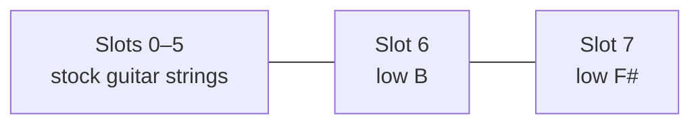

# 12. Eight strings

Part of the [RS Extended Range architecture](../ARCHITECTURE.md).

Eight-string guitar support is always on. A leftover `[neck] eight` key is ignored and logged. The native
layouts, the tuner, the tuning names and the chord data all have room for eight strings.

## How the slots fit together

The mod keeps the game's six string indices and adds two. This is **storage order**, not pitch order.

| Area | What changes for string 7 |
|---|---|
| Records | Eight-slot chord and note records replace the seven-bound versions. Slots 6 and 7 remain empty for stock six-string songs. |
| Tuner and names | The native tuner and the eight-string name families (such as `F# Standard`) include it. Names can carry the `8Str` mark. See [Tuner and tuning names](08-tuner-and-tuning-names.md). |
| Highway | Note lanes, section masks, bends and the native string get an eighth slot. Chord frames are scaled from the lane positions instead (see [Chord frame](#chord-frame)). |
| Headstock | Eight strings use an eight-peg in-line model. The same frame keeps a seven-peg model for seven strings. |
| Color | `[color] string7_color` and `string7_color_cb` default to pink `FF66CC`. The V7 ramp band colors the gems. Without the ramp bands, the gems use string 5's row. |

## What was checked

**Release-tested, 2026-10-31:** the extended-range test matrix covered seven- and eight-string guitar
and five- and six-string bass. It used both hands, both headstock settings, single player and co-op, and
ran through to the song review screen.

**CONFIRMED in automated in-game runs, 2026-10-29:** the tuner, pegs, letters, names and lanes were
checked for those instruments. The runs used in-line and 3+3 frames, normal and colorblind colors, and
RSMods Extended Range on. That record did not yet include tests with a real instrument.

## Eight-slot patches

The 24 E8* sites in `src/features/nslot/registration.cpp` are the eight-slot bounds of N-slot loops. Each
one changes the stock `cmp ...,6` to `cmp ...,8`.

<b>Site inventory and bounds evidence</b>

The former seven-slot sites were NR2, NR4, NR6, NB2, NS3, NS4, NS5, NS8, SH2, SH4, BH1, HS2, NM1, NM5,
NM6, FG3, FG8, SMb, SMc, CN2, CN3, CC2, BF1 and CH2. The 25th seven-bound site, PSQ1, is not
written with C-lite. GKC writes the peg word for eight instead.

**CONFIRMED statically:** each indexed array is a superset record slot (T8
frets/fingers/MIDI or C8 mask/slideTo/slideUnpitchTo/bends), a native FretGrid row (`264h = 8 × 4Ch`)
or a capacity-eight color table. The FG3/FG8 masks are per finger. SMb's `1 << string` fits the
section's mask byte. BF1 targets a `184h` stack local that holds one string's BendData32.

**HYPOTHESIS:** NR4/NB2 may pass string 7 to unaudited readers when a chord sounds string 7 alone.
CH2 sends string 7 to `eval+C1Fh` inside the `0xC28`-byte eval. That path also needs checking.

## Rendering and note behavior

| Feature | Implementation |
|---|---|
| Bend direction | BD1–BD4 give string 7 string 0's direction, as for string 6. N18–N20 handle single-note bends and release. |
| Section masks | N12 lets a string-7 note set bit 7; N13 back-fills it. |
| Chord pluck | PL1 `0x7E2EFE` reads T8 `frets[6]` and `frets[7]`. |
| Headstock | `rsxr_inline8[_lh].nif` supplies `Locator_Peg_8` and `string_size_8`; see [Headstock model](05-rendering-the-extra-strings.md#headstock-model). |

### Chord frame

`Rnd_GemGeom_ApplySpan` sets the string-axis scale to 1 and calculates only the fret-axis extent. It has
no count parameter, so B1/B2 scale the frame from the lane positions instead. **HYPOTHESIS:** an
eight-string neck keeps the seven-string lane spacing.

### Vibration at note end

C-lite raises `InstrumentInfo +0Bh` to the build count. A stock comparison can then let strings 6/7
reach six-slot arrays (`+4` main, `+1Ch` ghost), where string 6 would read ghost 0.

CLVE `0x7E442E` is the note-end stop of the GSVB vibration loop. It gives strings 6/7 the native main
string. N18–N20 send strings without a native path to the stock target. **HYPOTHESIS:** this was the
cause of the stuck vibration on the added strings, and CLVE fixes it. An in-game check was still needed.
