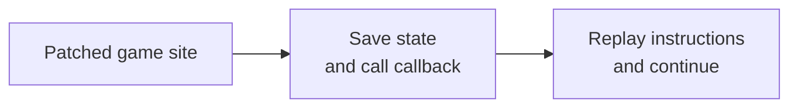

# 14. Mid-hook contract and cold-site conversion

Part of the [RS Extended Range architecture](../ARCHITECTURE.md).


This chapter is the design record of the generic mid-hook (`src/platform/midhook.*`) and of the work to
convert hand-written naked stubs to it. The evidence tags mean the same as in the other
chapters. All measurements come from one machine and one microbenchmark.

## Reading map

When you add a hook, start with the **contract** and the **relocator**. The mode sections explain which
CPU state each thunk preserves. The conversion sections explain how the old and new paths are compared.

| Mode | State saved by the thunk | Use and constraint |
|---|---|---|
| Full | General registers, flags and floating-point state | General callbacks; x87 changes use the context accessors. |
| Light | General registers and flags | Callback and callees must not use x87, MMX or SSE. |
| SSE | General registers, flags, XMM0–7 and MXCSR | Floating-point callbacks using SSE; callback and callees must not use x87 or MMX. |

The callback can inspect or change the saved context. Unless it chooses a different continuation,
the relocated instructions replay and execution returns to the game.



The diagram shows the normal replay path. A callback may instead select a validated continuation.

## Source

Builders create per-site entries that jump to shared MASM thunks. Native tests, emulator tests and the benchmark use those same thunks.

<details markdown="1">
<summary><b>Source and implementation evidence</b></summary>

`RsxrMid_Build`, `RsxrMid_BuildLight` and `RsxrMid_BuildCall` (`midhook.cpp`) emit the per-site entries at
runtime. The three shared thunks they jump to, `RsxrMid_Thunk`, `RsxrMid_ThunkLight` and `RsxrMid_ThunkSse`, are
in one MASM file, `src/platform/midhook_thunks.asm`, not in inline `__asm`. The file is built with ml.exe, wired
into `rsxr.vcxproj` and `tests/rsxr_tests.vcxproj` through the `masm` build customization, and exported with
`PROC EXPORT`. The WOW64 syscall of `Rsxr_Protect` is in `src/platform/protect_syscall.asm` the same way, so
`src/platform/` has no inline assembly.

The thunks are in a MASM file so that they stay ordinary code in the image's `.text` with the same exports. The
native tests, the emulator tests (which load the DLL and run the exported thunks in Unicorn) and the benchmark
use them unchanged. The assembler also reads like the old inline block, with labels, comments and a `FOR` macro
for the light thunk's unrolled copy. Emitting the thunk bodies as bytes at runtime would need executable storage
and a byte emitter for about 70 instructions. It would also hide them from the export table and the emulator
harness, and it would buy nothing in speed.

The move changed no byte. CONFIRMED: both thunks in `dinput8.dll` are byte-identical to the inline-asm build
(`f7cb7e8`, 92 and 159 bytes). The pre-guard benchmark was unchanged by the move (full 150-157 ns, light
21-25 ns before and after, three runs each).

Since beta.4, every thunk calls the callback through `RsxrMid_Guard` (`midhook.cpp`) instead of directly. The
guard copies the Context and runs the callback inside `__try`. On a fault (access violation, divide by zero,
illegal instruction, an escaped C++ exception) it restores the copy. The site then resumes with its own registers
and default continuation, as if the callback had not run. The guard also undoes what lies outside the Context.
An SSE-mode `LoadSt0` is dropped, so the replayed displaced `fld` is the only load. A full-mode FXSAVE image gets
its first 160 bytes back (control words and ST0-ST7, which is everything the St0 edits touch). Other memory that
the callback wrote before the fault stays written.

A lock held at the fault stays held, because with `/EHsc` the unwind runs `__finally` blocks but not C++
destructors. The next hit would then hang the game instead of crashing it. So a callback never reads game memory
or calls game code while it holds a lock. Read before taking the lock, read through the fault-safe helpers
(`Rsxr_SafeCopy`, `Rd`), or catch the fault inside the locked region as `RefOp` in `diagrams/hooks.cpp` does.

Faults are counted, and the first 20 are logged as `hook fault: callback dinput8+<offset>`. The guard's normal
path has no FPU or SSE code (it copies with REP MOVSD), so the light and SSE thunks keep their no-x87 contract. On
a fault from a light or SSE callback, the logger runs between an FXSAVE and an FXRSTOR of the guard's own, because
formatting a line may use x87 and XMM registers. `test_midhook_guard.cpp` covers both thunk kinds and the SSE and
FPU cases.

The cost, from the benchmark below on an idle machine (three runs), is 50-51 ns per light hit (21-25 before),
55-59 ns per SSE hit and 237-245 ns per full hit (150-157 before). The full thunk also copies the 160 bytes of x87
state twice. So the guard adds about 27 ns per light hit and about 85 ns per full hit. 200 light hits per frame
cost about 10 us, which is inside the budget below.

</details>

## Contract

The callback receives a `Context` and must return normally without throwing. It can edit registers, flags, ESP and the continuation (`jump`).

- Leave `jump` unchanged to replay the displaced instructions. Choose a validated continuation to skip or redirect them.
- Provide at least 40 writable bytes below the requested ESP, plus stack space for the callback.
- The floating-point state depends on the selected mode. See the mode table above.

<details markdown="1">
<summary><b>Context layout and continuation rules</b></summary>

`RsxrMid::Context` is 44 bytes: EDI, ESI, EBP, original ESP, EBX, EDX, ECX, EAX, EFLAGS
(nine dwords), then the thunk-owned `fpu` slot (the callback address on entry; while the callback runs the FXSAVE
image in full mode, 0 in light mode, the result block with bit 0 set in sse mode) and the writable `jump`. Compile-time offset assertions
bind it to the thunk. GPRs, ESP, flags and `jump` are writable; the callback is `cdecl`, must return
normally and must not throw. Segments are the process ABI. In full mode x87/MMX/SSE/MXCSR are saved with FXSAVE
and restored with FXRSTOR, so a callback changes the resumed floating-point state only through the x87 accessors
(below); light mode saves no floating-point state, sse mode only XMM0-7 and MXCSR (their own paragraphs below; AVX
upper halves and privileged state are outside the game's ABI). The generated 15-byte entry pushes the replay
address and the callback, then jumps to the shared thunk; the full thunk saves GPRs and flags, copies the context,
aligns a 512-byte FXSAVE area, clears DF, initializes x87, calls C++, restores floating-point state
and copies the edited register frame under the requested ESP (direction-aware for overlapping
frames), then POPAD/POPFD/RET. ESP is the site's pointer, not PUSHAD's; at least 40 writable bytes
below the requested ESP and enough stack for the callback are required. Bytes below the live stack are
scratch for both the thunk and the old stubs, so equivalence compares live memory only.

`jump` starts at the relocated copy of the displaced instructions. Leave it unchanged for normal replay. You
can also set it to one of these:

- `site + length`, to skip the replay. The callback then does the stock work itself, including any `push`.
- a branch target of the displaced code
- another validated continuation

Never target the middle of an instruction or the hook's own entry. A trailing displaced `RET` already returns
directly. `Context::Compare32(lhs, rhs)` reproduces the arithmetic flags of `cmp` and keeps every other flag. Use
it when the stub being replaced left comparison flags that a continuation could read.

</details>

## Relocator

The relocator accepts a whitelist of instruction forms and rejects unsupported encodings. It never blindly copies unknown instructions. Relative branches are remapped. Live unload is not supported.

<details markdown="1">
<summary><b>Supported instructions and test evidence</b></summary>

Whitelist only (see [chapter 2](02-patch-mechanism.md)), a table of position-independent operand forms (ModRM, imm8,
operand-sized immediate, moffs32, allowed ModRM.reg values) plus the relative transfers: accepts one
operand-size prefix `66` except on transfers, x87 and `SETcc`; rejects every other prefix,
indirect transfers, unknown opcodes, branches into instruction interiors and internal calls; widens
relative branches and remaps internal ones; no blind-copy fallback. `tools/midhook_survey.py` runs the
built relocator over every jmp site and lists the rejected ones with the first rejected encoding: 22 of
210 before `INC`/`DEC r/m8`, `IMUL` (`0F AF`, `6B`, `69`), `TEST r/m,imm` (`F6`/`F7 /0`) and `66` were added,
2 after (W: `fcomp`, BT1: `RET imm16`); `RET imm16` is now copied as a terminal instruction like `RET` (position
independent, only as the last displaced instruction), and FCOMP m32 (`D8 /3`, memory forms only: a memory operand is
position independent in 32-bit code) is accepted, so none is left. CONFIRMED by `tools/tests/test_midhook_relocate.py`: the relocated
copies of 14 of those sites execute like the stock bytes in Unicorn (GPRs, EFLAGS, exit, writes). `tools/sitecheck.py` still checks whole instructions and inbound
branches. A relocated `CALL` runs from the thunk's copy, so the callee sees a different return address
than at the original site (stubs that tail-jump into the callee kept the original one). Live unload
needs thread quiescence and is unsupported.

</details>

## Pilot (SE1/SE2/SE3, song-end diagnostics) - CONFIRMED

The old stubs ran `cmp` on `g_rsxr_endlog` before they saved anything, so the callback reproduces those
flags. The logger takes `Context` plus the original stack pointer. It never takes `&ctx.edi` as a PUSHAD frame,
because the private fields would then pose as the return address and argument. 180 old-vs-new Unicorn
comparisons pass (3 sites x 5 setting values x 3 incoming flag patterns x 2 stack alignments x 2 helper
behaviors).

## Conversion method

The emulator runs the frozen old stub and the new hook against the same machine state, then compares the continuation, registers, flags, memory and helper calls.

<details markdown="1">
<summary><b>Oracle coverage and flag contract</b></summary>

For every converted site, the old compiled stub is frozen with `tools/freeze_stubs.py` from a DLL built
before the change. The frozen stub is bytes plus symbolic fixups, verified by re-linking, with no game bytes.
`tools/tests/test_midhook_cold.py` / `midhook_oracle.py` then run it and the production entry + callback on
identical machine state in Unicorn. Compared: all eight GPRs, EFLAGS, the exit
taken (final EIP), x87 status/top/ST0-1, XMM0/XMM7, the live stack from the first pushed byte up, a
data page, every other machine write, exported switches, and the complete input of every helper call
(arguments, pointed-to bytes, order). Helpers are replaced by `ret` that dirties EAX/ECX/EDX, flags and
XMM, and return configurable values so both branches of each site run. Each case runs with three
incoming EFLAGS patterns (one with DF) and two stack alignments; switches use noncanonical values
(2, 0x80000000, 0xffffffff) too. Flag contract: the arithmetic flags equal the old stub's where its
replayed or compared instruction writes them ("exact"); where the old stub left helper-dependent
flags that no continuation reads ("dead") the hook leaves the incoming ones; every non-arithmetic bit
(DF, IF) is always the incoming one, which the old stubs did not guarantee. The frozen file is
`tools/tests/fixtures/midhook_cold_951f935.json` (stubs as built at `951f935`).

</details>

## What converts and what stays

**HYPOTHESIS:** cold sites that are hit rarely fit the cost budget of the full thunk. Hot sites need a cheaper mode, profiling or hand-written code. Sites with some calling conventions, and return-address-sensitive sites, also stay hand-written.

<details markdown="1">
<summary><b>Site selection and exceptions</b></summary>

HYPOTHESIS (estimate, not measured runtime frequency): load, free,
setup, song-start and teardown hooks with straight replay run rarely enough that the thunk's
fixed cost is irrelevant. Hot per-note, per-frame, lane, grid, color, pitch and audio-thread hooks stay
hand-written until profiling justifies full-context overhead (or convert to the light mode below once its callback is integer-only). Wrappers that call the original and do work
around it use the Wrap placement (below). Also stay hand-written: callee `RET imm` cleanups and epilogues, replaced `CALL` sites
that tail-jump, sites whose displaced bytes use a prefix other than `66` or INT3 padding, custom saved-frame consumers,
stack probes and return-address-sensitive callees (table below). A converted site either leaves the
replay alone (the callback only observes or calls a helper) or skips it (`jump = resume`) and performs the
stock instruction's effect itself; where the old stub left compare flags, the callback reproduces them
(`Context::Compare`).

</details>

## Light mode

**Use light mode for hot, integer-only callbacks.** The callback and everything it calls must avoid x87, MMX and SSE. Even struct copies or zero-initialization can generate those instructions. Register the callback in `LIGHT_CALLBACKS` so that the emulator checks it.

<details markdown="1">
<summary><b>Thunk behavior and verification</b></summary>

`RsxrHook::midMode = RsxrMid::Mode::Light` (`RsxrMid_BuildLight`) uses the same 15-byte entry,
`Context` layout and continuation rules, so converting a stub is only writing the callback. Its thunk
(`RsxrMid_ThunkLight`) saves GPRs and EFLAGS, places the context 44 bytes below the entry slots as the full
thunk does (a callback may still `Push` up to eleven dwords), clears DF, calls C++ and writes the edited frame
back with unrolled moves (no REP MOVSD, no STD). It does no FXSAVE, FNINIT or FXRSTOR and no 16-byte stack
alignment. Contract: the callback and everything it calls execute no x87, MMX or SSE instruction (they would
change the game's live floating-point state). In MSVC with `/arch:SSE2` that excludes not only `float`/`double`
but also zero-initialized structs and arrays and struct copies, which the compiler emits as `xorps`/`movups`/`movq`
(several existing cold callbacks contain exactly that). Enforcement: a site listed in `LIGHT_CALLBACKS`
(`tools/tests/emu_harness.py`, kept in sync with the registration) is built with the light builder in the
emulator tests, and `test_light_callbacks_use_no_fp` disassembles its callback and every direct callee
(recursive descent) and fails on any x87/MMX/SSE instruction or unverifiable indirect jump. CONFIRMED (emulator,
`test_light_thunk_executes_no_fp_and_keeps_fp_state`): with CR0.TS set, so that any floating-point instruction
would raise #NM, the light thunk runs to the continuation, preserves all GPRs and EFLAGS and leaves the FXSAVE
image unchanged; the full thunk faults under the same setting. The generic emulator tests (real-site replay,
relocated JCC/CALL, register/flag/ESP/jump edits) run against both thunks.

</details>

## Sse mode

**Use SSE mode for hot callbacks that need SSE.** The thunk preserves XMM0–7 and MXCSR. Callbacks and their callees must avoid x87 and MMX. Register the callbacks in `SSE_CALLBACKS`. Use `RsxrMid::LoadSt0` when the game needs an x87 result.

<details markdown="1">
<summary><b>Floating-point behavior, limits and verification</b></summary>

`RsxrHook::midMode = RsxrMid::Mode::Sse` (`RsxrMid_BuildSse`; mode 2 for `RsxrMid_BuildCall` /
`RsxrMid_BuildWrap`) is for hot sites whose callback computes with floats: the light thunk's frame handling plus
XMM0-7 (MOVUPS, unaligned) and MXCSR (STMXCSR / LDMXCSR) around the callback, which runs with MXCSR `1F80h` (round to
nearest, exceptions masked, no FTZ / DAZ) whatever the game set. No FXSAVE, no FNINIT: the game's x87 stack stays
live, so the callback and its callees execute no x87 or MMX instruction. With MSVC `/arch:SSE2` that rules out a
non-inlined function returning `float` / `double` (the x86 ABI returns them in ST0; `RsxrS7_ExtrapolateLane` is inline
for this) and CRT math. An x87 result goes through `RsxrMid::LoadSt0(c, value)`: `Context::fpu` points at a result block
(`RsxrMid::SseResult`, bit 0 set; the x87 accessors see no image and fail), and after restoring the thunk does
`fld dword` of the value, as a displaced `fld dword [..]` would (one load per hit; a full stack faults like the game's
own `fld`). The gap below the entry slots is 52 bytes, so the block and the context tail stay below the eleven dwords
a callback may `Push`. Enforcement: `SSE_CALLBACKS` (`tools/tests/emu_harness.py`) selects the builder in the emulator
tests, and `test_sse_callbacks_use_no_x87_or_mmx` runs the light check's scan allowing XMM instructions, with no
exemption: R2's D1 logger `Rsxr_DiagNoteHead` only queues the line (integer, a lock-free 16-slot ring) and the full-mode
diagnostic hooks D2 D3 D5, written under the same `[debug] diagnostics=1`, log it (`RsxrDiag_FlushNoteHeads`). CONFIRMED:
`tests/test_midhook_sse.cpp` (hardware: the loaded value, XMM / MXCSR / x87 state around the hook, `LoadSt0` fails in
the other modes), `test_midhook_emu.py` (Unicorn: registers, flags, ESP edits and real-site replay against all three
thunks; the callback sees MXCSR `1F80h` and the game's x87 stack). Cost: see the table under "Cost". `Context::Add32`
(ADD's flags, like `Compare`) and `Context::CompareSt0` (the exact order of the 80-bit ST0 against a float, as `fcom`;
`St0()` rounds to double) were added for R2 / R6 and W; both are checked against the hardware.

What the converted float sites guarantee (`tools/tests/test_midhook_sse_sites.py`, against the frozen stubs and the
stock bytes): R2 and R6 run to the game's next `fstp dword` (R2 `0x79E730`, R6 `0x7A8C30`, CONFIRMED by disassembly),
and the stored float, registers, flags (the `add`'s, `Add32`) and memory equal the old stubs' for exact, inexact,
overflowing and signed-zero lanes; the extrapolation is correctly rounded once (53 bits >= 2 x 24 + 2), as the old
x87 code's float was. Not covered: the x87 precision / underflow / denormal flags (contract `fsw="sticky"`, and no
denormal lane coordinates in the matrix: an x87 load of one raises DE), NaN payloads (x87 and SSE propagate different
NaNs when both inputs are NaN), and the game's x87 control word: the oracle runs with the FNINIT default (64-bit
precision, round to nearest); HYPOTHESIS: the game runs round to nearest at 24-bit or higher precision, where the
stored float is the same. W compares the 80-bit mean exactly (a mean one 64-bit ulp off 34.0 included); its replay
and the remap read the game's constant k at `0x1224C6C` (its address from the ref site `X_WTHR`, the operand of W's
`fcomp`), CONFIRMED 34.0 in the unpacked image; ST0 becomes k - 1, k or k + 1 (the old stub used its own 34.0f,
`g_rsxr_wrong_stock`, retired). The sse thunk on a full x87 stack loads like the game's `fld` (stack fault, compared
with the hardware), and `BuildCall` / `BuildWrap` run with mode 2 in their emulator tests.

</details>

## Call sites

A `RsxrKind::Call` site is a `call rel32`. At startup the mod retargets its rel32 to the hook's entry
(`RsxrHook::callback` on a call site, `RsxrMid::Hook::PrepareCall`, `RsxrMid_BuildCall`). Nothing is relocated, and
the game's own `call` pushes the real return address. Call sites use the same thunks, `Context`, full/light rules
and flag contract as jump sites. Only the entry and the meaning of `jump` differ. `RsxrHook::midCall` chooses them
per hook.

| Placement | Entry | When the callback runs | `jump` starts at |
|---|---|---|---|
| `RsxrMid::Call::Before` (default) | `push callee; push callback; jmp thunk` (15 bytes) | at the callee's entry: `esp` points at the return address (site + 5), arguments at `esp + 4` | the original callee |
| `RsxrMid::Call::After` | `lea esp,[esp+4]` (drops the game's return address, keeps the flags); `call callee; push site+5; push callback; jmp thunk` (24 bytes) | after the callee returned: EAX/EDX/flags are the callee's, `esp` is past its own `ret N` cleanup | site + 5 |

Before: leaving `jump` tail-jumps into the callee with the game's stack and return address unchanged (what the old
`jmp g_rsxr_target_X` stubs did); another `jump` replaces the callee (same convention); `RsxrMid::Return(c, value,
argBytes)` skips it: EAX = value, the return address and `argBytes` of a `ret N` callee are popped, and execution
continues at site + 5. After: the callback may replace the integer return value (EAX, EDX); the callee sees a return
address inside the entry, so return-address-sensitive callees (table above) cannot use it, as with a relocated
`CALL`. An x87 return value (ST0) can be replaced by a full-mode callback (`Context::SetSt0`, below), not by a light
one. The callee address is the first entry slot (Before) or bound to the hook's `target`
variable (both). After cannot read the pre-call arguments (they are below the live stack after the callee returned and
the thunk's scratch overwrites them); wrappers that need them use the Wrap placement below.
CONFIRMED by `tests/test_midhook_call.cpp` (native: registers, flags, stack, call / skip / `ret N` skip / replaced
return value, both placements and modes) and `tools/tests/test_midhook_call_emu.py` (the same in Unicorn against both
thunks). First converted site: SF1 (Before, full mode: the song destructor runs on a loader thread too), compared
with its frozen stub in `tools/tests/test_midhook_nslot.py`.

## Call-in entries

Call-in entries are calls inserted into relocated function copies. They use the same thunks and mode constraints as hook sites, but they have no original callee.

<details markdown="1">
<summary><b>Entry behavior and verification</b></summary>

The calls written into relocated function copies (platform/fncopy.h; a call edit replaces one
stock instruction or call with `call` + NOPs) are not sites: nothing is relocated and there is no callee. A
`RsxrMid::CallIn {callback, mode, argBytes}` builds the call entry with no callee (`RsxrMid_BuildCallIn`, 16 or 18
bytes): `push continuation; push callback; jmp thunk`, the continuation a `ret` / `ret argBytes` right after it. The
callback runs with the copy's registers and flags, `esp` at the copy's return address, arguments at `esp + 4`.
Leaving `jump` returns to the copy with the edited `Context` (registers, flags) and pops `argBytes` (a stdcall helper's
`ret N`); assigning it tail-jumps (into the stock callee, with the copy's stack: `Rsxr_CallIn_Attach` for strings 0-5).
A callback that must run a game function and continue afterwards pushes copies of its arguments and a second call-in
entry as the return address (`Rsxr_CallIn_Shape` / `Rsxr_CallIn_ShapeDone`), so the game function runs with the game's
own x87 state. The generators name the call-in object instead of a DLL function (`g_rsxr_callin_<name>`, the edit row's
`RsxrFnEdit::callin`); `RsxrFn_Build` writes `CallIn::Entry()` (built on first use, before the copy) into the copy. Same
thunks, full / light rules and cost budget as sites; a light call-in callback is checked for x87/SSE code like a light
site (`test_light_and_sse_callins_use_no_fp`). An x87 result (ST0 left for the copy) comes from an Sse-mode call-in
with `RsxrMid::LoadSt0`: the SSE thunk does the `fld` after restoring (`Rsxr_CallIn_GlowRead`, the GSGL copy's glow
read; frozen at `06733ba`). **Game code from a full-mode callback** runs under `RsxrMid::GameFcw` (`midhook.h`): the thunk's FNINIT
control word (37Fh, 64-bit precision) is replaced for the scope by the game's own from the saved image (the D3D9 device
sets 24-bit precision), as under the naked stubs these callbacks replaced. Audit (2026-10-18, every full-mode callback
that reaches a game function through `call` or a function-pointer cast): `Rsxr_CallIn_Attach`, AUD1, DGB, DGM, F1, FGHK,
GKT (around the rebuild: the callback uses `__try`), GSC1, IN1, MD1 (before), N5, NG9, PL1, PSL2, PUBGA, PUBGB, SF1,
TJ (both), TK, TN (both), TU, TUT, XB1. CONFIRMED by `midhook_game_fcw_runs_game_code_with_the_callers_control_word`
and the call-in oracle (it runs with the game control word 27Fh and records the one RsxrGs_AttachExt and the attach
stand-in see). CONFIRMED by `tests/test_midhook_call.cpp` (sizes, rejections,
the `ret N` return with edited registers in both modes) and `tools/tests/test_midhook_callin.py` (`callin_oracle.py`:
each call against its frozen asm helper and the edit's stock bytes in Unicorn).

</details>

## Wrap placement

Use `Wrap` when a callback needs to do work before and after a call, including when the after callback needs the original arguments. Return-address-sensitive callees need another approach.

<details markdown="1">
<summary><b>Frame layout, constraints and verification</b></summary>

`RsxrMid::Call::Wrap` is for the wrappers After cannot express: the callback needs the callee's
arguments or the registers it was called with after it returned, skips it conditionally, or passes it arguments it
builds itself. The entry runs the callee as a subroutine on **copies** of its stack arguments, so the originals stay
live above the game's return address for the whole call; nothing is added to `Context` and the thunks are unchanged.
Per site the hook row declares `RsxrHook::midWrap`, an `RsxrMid::Wrap {args, conv, locals}`: the stack argument dwords
to copy, who cleans them up (`Conv::Stdcall`, also for a thiscall callee: the callee's `ret 4 * args`; `Conv::Cdecl`: the
caller) and the bytes of scratch the callbacks may use (a multiple of 4, at most 256). The same constant is the
callbacks' view of the frame. The callbacks are `RsxrHook::midBefore` (optional) and `RsxrHook::callback` (after;
optional when there is a before callback), one mode for both. Entry (`RsxrMid_BuildWrap`), at the game's `call`:

```
push edx; push ecx; push eax; push 0     ; the frame: user dword, then EAX/ECX/EDX at the call
lea  esp, [esp - locals]                 ; scratch (omitted when 0)
[push C1; push before; jmp thunk]        ; before: jump = C1
C1: push dword [esp + locals + 16 + 4 * args]   (args times: the copies, last argument first)
call callee
[lea esp, [esp + 4 * args]]              ; cdecl: drop the copies the callee left
[push T; push after; jmp thunk]          ; after: jump = T
T:  lea  esp, [esp + locals + 16]
    ret  4 * args  |  ret                 ; the cleanup the game expects from the callee
```

Both callbacks see `Context::esp` at the frame, `RsxrMid::Frame(c, wrap)` (`midhook.h`):

| `c.esp + ...` | Content |
|---|---|
| 0 | `locals` bytes of scratch (`RsxrMid::Locals(c)`), uninitialized |
| `locals` | `user`: 0 at the call; the before callback may leave a value for the after callback (a handle) |
| `locals + 4 / 8 / 12` | EAX, ECX, EDX as the game called (not the before callback's edits) |
| `locals + 16` | the game's return address (site + 5) |
| `locals + 20 + 4 * i` | argument `i` (`Frame::Arg(i)`): the caller's own slot, which the callee never sees |

Before callback: the registers, flags and arguments the callee gets. It may edit registers (resumed into the callee)
and arguments (copied after it returns, so the callee sees the edits; a built argument may point into `Locals`), set
`user`, or skip the callee: `RsxrMid::WrapReturn(c, wrap, value)` (EAX = value, frame, return address and the callee's
cleanup popped, continue at the return address). After callback: EAX/EDX/ECX/flags and the x87 stack (full mode:
`St0` / `SetSt0`) are the callee's, ESP is the frame (the callee's copies are gone), the arguments and `user` are
readable; it may replace the return value; `jump` = T. A **jmp site at a function entry** may use the same placement
(`RsxrMid::Hook::Prepare` with a `Wrap`): the entry's callee is the relocated prologue followed by a jump to site +
length, i.e. the stock function, and T returns from the function. Limits: the callee runs with a return address inside
the entry and its arguments 16 + `locals` + 4 * `args` bytes lower than at the site (return-address-sensitive callees
and callees that read past their declared arguments cannot use it); register arguments are whatever the registers hold
(nothing to declare). An edit of `Frame::Arg(i)` lands in the caller's own slot: after the call that slot is popped
(stdcall) or dead (cdecl: the caller only drops it). Cost: one thunk pass per callback (two with a before callback),
the copies are a few pushes. CONFIRMED by `tests/test_midhook_wrap.cpp` (native: the original arguments after the call
under the callee's scribble, the frame registers, `user`, argument and register edits, skip with both cleanups, a
replaced return value, an argument built in the scratch, a function-entry wrap with its prologue replayed, an x87
result read and replaced in full mode, both modes) and `tools/tests/test_midhook_wrap_emu.py` (the same in Unicorn
against both thunks, the light entry under CR0.TS). Converted: PP1, IN1, F1, PSN2, AM1, TJ, TU, TN (conversion status
below), then MD1 (the oracle's `Spec.clobbers` declares ECX/EDX dead caller-saved registers at its return: the old stub
left the C helper's there). A call site whose old stub was a jmp over game code before the `call` (GSA1 `push 40h; call`)
is compared with `Spec.lead`: the old stub starts at site - lead, the new and the stock runs execute the original bytes
from there with the call retargeted.

</details>

## x87 ST0 (full mode)

Full-mode callbacks use the context accessors to inspect or edit the saved x87 stack. Light mode has no saved x87 image. SSE mode uses `LoadSt0` for an x87 result.

<details markdown="1">
<summary><b>Accessors, behavior and verification</b></summary>

The full thunk hands the callback its FXSAVE image (`Context::fpu`), and the accessors edit
the x87 stack in it before FXRSTOR: `FpuDepth()` (valid registers), `HasSt0()`, `St0()` (the 80-bit ST0 rounded to
double, round to nearest even; a quiet NaN on an empty stack), `SetSt0(v)` (replace ST0, depth unchanged; fails on an
empty stack) and `PushSt0(v)` (what `fld` does: TOP - 1, the value in ST0, C1 = 0, the tag bit set; fails when all
eight registers are valid, where `fld` would overflow). The image keeps ST(i) in stack order and the abridged tag
byte by physical register, so a push shifts ST0..ST6 down and updates TOP and the tag together; FXRSTOR then loads
a consistent stack. The conversions are integer code (no x87 instruction, no dependence on the callback's control
word): double -> 80 bits is exact (a signaling NaN is quieted, as `fld qword` does), 80 bits -> double rounds as
`fstp qword` does under the FNINIT control word (unnormals give the default NaN). Light mode has no image: `fpu` is 0,
`FpuDepth()` is 0 and every edit fails, and a light callback still must not execute floating-point code (the accessors
take and return `double`). CONFIRMED by `tests/test_midhook_st0.cpp` (native, real entries): round trips of zero,
signed zero, normal, `DBL_MIN`/`DBL_MAX`, the smallest and largest denormal, infinities and NaNs with payload (TOP and
tag unchanged), `SetSt0` bytes equal to the hardware `fld` of the same value, round-to-nearest-even ties and the carry
into the exponent, push / full-stack refusal and the light-mode case. Jump-site callbacks run before the replay, so an
x87 result of the displaced code is produced by skipping the replay and pushing it (`PushSt0`), as R3a-R3c and R4 do
(`features/string7/hooks_lanes.cpp`, string 6: `2 * cell0 - cell1` (`RsxrS7_ExtrapolateLane`) into the scratch vec3,
EAX = the scratch, ST0 = its x, R4 also its `pop esi`). On a full x87 stack `PushSt0` refuses (both edits are
`[[nodiscard]]`); the hook then rebases EAX so that the replayed `lea; fld` loads the scratch, overflow included,
which is what the old stub did, and logs it once. Their float result equals the old x87 code's for finite results (both correctly
rounded: 53 and 64 bits are at least 2 x 24 + 2); the sticky x87 exception flags (precision) the old arithmetic
raised are not reproduced, which the oracle contract `fsw="sticky"` states (Unicorn does not raise the precision
flag, so the emulator cannot show that difference; HYPOTHESIS: the game reads no sticky x87 flag). Cost: HYPOTHESIS
within the budget, they run from `Rnd_NoteFx_Spawn` / `Rnd_NoteFeedback_Spawn` (CONFIRMED call graph), once per
spawned effect, not per frame. R2 (note head z, per note and frame) and R6 (lane offset, `Rnd_GemLaneOffset_Update`,
per gem and frame) also leave an x87 result but are over the full mode's budget: sse mode (below).

</details>

## Atomic sites

A `jmp_atomic8` site is installed with one locked qword exchange, because the code may run on another thread while it is patched. Whether that is enough for cross-modifying code is an open risk ([plain PSARC loading](10-plain-psarc-loading.md)).

<details markdown="1">
<summary><b>Examples and verification</b></summary>

A `jmp_atomic8` site is a 5-byte jmp inside one aligned qword, written with one locked exchange
(the code may run on another thread while it is patched). A mid-hook is prepared for it as for a `jmp` site, with the
whole `expect` span as the replay (the jmp ends inside an instruction, which the relocator would reject), and startup
writes the entry with the same locked exchange (`Rsxr_PrepareMid` in `platform/hooktable.cpp`, called and applied from `startup_sites.cpp`; one condition more). S3 and
PT1 (the guitar / bass exits `mov [eax+1356h],cx|dx; ret` of `Play_Detector_SetTuning`, cold) are the first: the
callback does the store itself, calls the helper, which sees the finished detector as before, and returns for the
function (`RsxrMid::Ret`); the old stubs left the helper's flags at the return, where no one reads them (contract
"dead"). Compared with their frozen stubs in `tools/tests/test_midhook_x87.py` (fixture `midhook_318618f.json`, with
R3a-R3c and R4).

</details>

## Cost

These numbers come from a native QPC microbenchmark (`tests/test_midhook_bench.cpp`). It uses a dummy
`mov eax,7; ret` site and a no-op callback, and reports the median of 7 x 200,000 hits over several runs
(Ryzen 7 5800X, Release Win32). CONFIRMED with `RsxrMid_Guard` on an idle machine (three runs).

| Production mode | ns per hit |
|---|---|
| Full | 237-245 |
| Light | 50-51 |
| SSE | 55-59 |

The older measurements below are from **before the guard**. They compare the thunks of that time with
ablated copies of the full thunk.

| Variant | ns per hit | Over stock |
|---|---|---|
| stock code / direct `call` to the callback | 1.3-2.7 / 2.2-3.6 | - / about 1 |
| full thunk (pre-guard) | 149-162 | 146-160 |
| full without FNINIT | 123-137 | 122-135 |
| full without FXSAVE / FNINIT / FXRSTOR | 64-72 | 62-70 |
| **light thunk (pre-guard)** | **19-26** | **17-25** |
| **sse thunk (pre-guard)** | **20-31** | **18-30** |
| PUSHFD / PUSHAD / call / POPAD / POPFD only (lower bound, not a valid thunk) | 18-24 | 15-21 |

The pre-guard full thunk took about 150 ns. FXSAVE + FXRSTOR took about 65 ns, FNINIT about 20 ns, the two
REP MOVSD context copies with STD/CLD about 45 ns, and the register save and call about 20 ns. The HYPOTHESIS that
most of the cost is FXSAVE/FXRSTOR is partly CONFIRMED. The floating-point handling is the largest part (about
57 % with FNINIT, 42 % without), but the string copies are a third of the cost. That is why the light thunk also
unrolls them.

These numbers are not frame time, and the callback's own work comes on top (a 64-entry table scan for the PegSet
sites, a short loop for GSSS/GSSE). With the guard, 10,000 hits per frame cost about 2.4 ms in full mode, 0.5 ms
in light mode and 0.6 ms in SSE mode. Use full mode where hits per frame x 245 ns stays well under about 20 us.
That covers per-frame drivers, a few calls per frame, and code that runs per song, per load or once per event.
Hot sites use light mode for integer-only callbacks, SSE mode for SSE math without x87, or asm.

HYPOTHESIS (hit counts not measured in game): the converted sites run a few to a few dozen times per guitar load,
tuner session or song (PSM2 at most 8 per renderer setup). That is well under 10 microseconds per song.

## Remaining stubs

Keep a hand-written stub only when a mid-hook cannot express the site. The stub must preserve the game state and document the site, the original behavior and the changes.

<details markdown="1">
<summary><b>Stub contract</b></summary>

The few naked stubs left (in `src/features/<name>/hooks_stubs*.cpp`: chords, headstock, nextgrid, nslot, pitch;
each file starts with a map of its stubs) keep these rules: a stub is a naked function the patcher jumps to from a game address; it replays
the displaced instructions, does its work and jumps back. It is exported as `Rsxr_Stub_<ID>` with its link variables
`g_rsxr_resume_<ID>` (site + length; the stub ends with `jmp g_rsxr_resume_<ID>`) and `g_rsxr_target_<ID>` (an
original branch / call target), all plain `extern "C" __declspec(dllexport)` declarations in the stub's file. It
preserves every register and flag the stock code reads afterwards (flags only where the comment says "flags dead"),
leaves the x87 / SSE state alone unless the comment says it is saved, and never names an inline-asm operand like a
register or mnemonic (C4405 is an error). The comment above a stub says where (site, address, function), what the
stock code does and what changes. No new stub where a mid-hook does the job.

</details>

## Conversion status

This section lists which site families are mid-hooks and which are still stubs. For each converted site it
names the source file and the emulator test that compares the site with its frozen stub. "stub frozen at
`<commit>`" names the build of the fixture.

<details markdown="1">
<summary><b>Site-by-site status</b></summary>

"stub" = still hand-written. The batch and pass names in the table are the conversion rounds the fixtures and
test files are named after.

| Family | Sites | Status |
|---|---|---|
| song end log | SE1-SE3 | mid-hook (pilot) |
| tuner session / tuning names / SNG load | TK, TS, TUT, XB1 | mid-hook |
| pool request counts, GuitarStrings / InstrumentInfo / PegSet free sizes | N1, N21, GSZ1, GIZ1, PSA2 | mid-hook |
| native PegSet destructor / unload / ctor / load | PSD1, PSD2, PSU3, PSC1, PSL1 | mid-hook |
| native PegSet mesh latch / color reset / color name; GuitarStrings dimming at song start / end | PSM2, PSR1, PSN1, GSSS, GSSE | mid-hook |
| relocator rejected the displaced bytes before PR #54 (`66`, `INC`/`DEC r/m8`, `IMUL`, `TEST r/m,imm`); `fcomp` since the sse pass | W | mid-hook, full mode (`features/tuner/hooks.cpp`: the replayed `fcomp [34.0]` on ST0 remapped to 33 / 34 / 35 by `Context::CompareSt0` against the session threshold; BT1 went with `RET imm16`; PSU1, PSU2, PSM1, NG1, PUBEDGE, CLBM, CLBA in batch 5) |
| sse pass (stubs frozen at `7f80b7b`, `tools/tests/fixtures/midhook_7f80b7b.json`, `tools/tests/test_midhook_sse_sites.py`, frozen stubs and stock bytes): string 6's note head z and lane offset y per note / gem and frame (`LoadSt0`); the per-cell position query, the whole function (`RsxrMid::Ret`) | R2, R6; PUBGP (R1) | mid-hook, sse mode (`features/string7/hooks_lanes.cpp`, `features/publish/hooks_gridsites.cpp`) |
| call-kind sites that stay asm: call game functions with a custom convention (B2), a cdecl C++ function that replaces the callee directly, no stub (PP_SNGD) | PP_SNGD, B2 | stub (reasons in the stubs' header comments) |
| call sites, batch 4: string-mask test (callee replaced, `RsxrMid::Return`) and eval target arrays (one callback each, light); song tuning, tailed expected pitch of a tracked note / an analyzed mistake (full); PegSet load complete (After placement, full) | TM1-TM6, EV1-EV5; S4, PC2, PC3; PSL2 | mid-hook (`features/nslot/hooks_calls.cpp`, `features/pitch/hooks_calls.cpp`, `features/headstock/hooks_mid.cpp`; stubs frozen at `b6071a8`, `tools/tests/fixtures/midhook_b6071a8.json`, `tools/tests/test_midhook_calls.py`) |
| Wrap placement (full mode): wrappers that read the callee's arguments or the registers it was called with after it returned (PP1, IN1, F1), skip it (PSN2), build its arguments in the scratch (AM1), hand a handle from before to after (TJ, TU, TN; within the budget, CONFIRMED in game with a temporary per-second hit counter, 2026-10-18: TJ about 194 calls once per song-list build, then 0 while the list or a song is shown; TU 1 per song start; TN 1 every 2-3 s in the pause tuner and the menu tuner, 0 during a song. Never per frame: with the guard, the largest burst costs about 95 us once (194 calls, two full-mode callbacks each)) | PP1, IN1, F1, PSN2, AM1, TJ, TU, TN | mid-hook (`features/nslot/hooks_wrap.cpp`, `features/frets/hooks_wrap.cpp`, `features/headstock/hooks_mid.cpp`, `features/tuner/hooks_wrap.cpp`; stubs frozen at `b72bc52`, `tools/tests/fixtures/midhook_b72bc52.json`, `tools/tests/test_midhook_wrap_sites.py`, which also runs their stock-bytes references) |
| asm-reduction pass (stubs frozen at `b72bc52` / `c15ca8d`, `tools/tests/test_midhook_asm_sites.py`, frozen stubs and stock bytes): the guitar ctor's allocations and GuitarStrings ctor re-sited to their `call` (GSA1 Before: the size argument; GSC1 Wrap: the entry runs the stock ctor with the game's x87 state, RsxrGs_Construct adds the native layout after it; GIA1 Wrap: size before, extension after), MD1 (Wrap, a function entry), GRM3 (`PushSt0`, cold), BT1 (the relocated `ret 14h` epilogue, full: memcpy), AG1-AG3 and PE0 (whole functions answered by a light callback, `RsxrMid::Ret`; PE0 per note) | GSA1, GSC1, GIA1, MD1, GRM3, BT1, AG1-AG3, PE0 | mid-hook (`features/strings/hooks_mid.cpp`, `hooks_wrap.cpp`, `features/nslot/hooks_wrap.cpp`, `hooks_eval.cpp`, `features/pitch/hooks_mid.cpp`) |
| asm reduction part 2 (stubs frozen at `72da588`, `tools/tests/fixtures/midhook_72da588.json`, `tools/tests/test_midhook_asm_sites2.py`, frozen stubs and stock bytes): the per-frame tailed expected pitch of a tracked note (PC1, PC4: light call sites, Before; `RsxrPitch_Tailed` reads the registry of tailed allocations instead of `_msize`), the standard-zero expected pitch (PUBZ0, PUBZ4-6 call sites, PUBZ1-3 jmp sites whose replay is the relocated `jmp`; one light callback for the old `Rsxr_Publish_ZeroRaw`) and the PUBAN copy's call of the expected pitch over the tail (a light call entry built at copy time, `Rsxr_Mid_PubTailPitch`, for the old `Rsxr_Pitch_Raw8`) | PC1, PC4, PUBZ0-PUBZ6 | mid-hook (`features/pitch/hooks_calls.cpp`, `features/publish/hooks_pitch.cpp`) |
| bend direction guards (light mode); gem position log, chord frame marks (full mode, their helpers use SSE) | BD1-BD4; D5, B1 | mid-hook (refactor step 7, stubs frozen at `0cf5874`, `tools/tests/fixtures/midhook_0cf5874.json`) |
| string 6 in the SNG section mask (song load); native pitch tails at matcher creation, detector reset, matcher tuning | N12, N13; PM0, PR0, PM1 | mid-hook, full mode (refactor step 7 batch 2, stubs frozen at `24bfba8`, `tools/tests/fixtures/midhook_24bfba8.json`) |
| tuner camera reference string, slide end cell stride (light) | TF1, V2 | mid-hook (refactor step 7 batch 3, `features/tuner/hooks_camera.cpp`, `features/fretgrid/hooks_slide.cpp`; stubs frozen at `b8c0ed7`, `tools/tests/fixtures/midhook_b8c0ed7.json`) |
| N-slot template / ChordNotes redirects (one callback, a per-site register table); eval arrays, tails, mask test, child slots; technique-check latches (light; TP11, DS1 on the loader thread and PL1 with its FP pluck helper: full) | TP1-TP8, TP11, TP12, CP1, CP2, DS1; LU3, WC2, CS1, CC3, CH3, PL1; UP1-UP3, PD2-PD5 | mid-hook (batch 3, `features/nslot/hooks_records.cpp`, `hooks_eval.cpp`, `hooks_latches.cpp`; `tools/tests/test_midhook_nslot.py`) |
| N-slot sites that call game code from the live tracker state | RL1, RL2 | stub (reasons in the header of `features/nslot/hooks_stubs_tracker.cpp`) |
| calls written into the GuitarStrings copies, call-in entries: template record (TP2), glow ramp, headstock segment flag / color, shape lookup (light); glow color, attach point (full: float helpers); glow read (sse: the x87 result via `LoadSt0`, frozen at `06733ba`); the helper `Rsxr_NsTplAt` went with TP2 | `Rsxr_Call_TP2`, `_GlowSetup`, `_GlowColour`, `_HsLoaded`, `_HsSeg`, `_Attach`, `_Shape`, `_GlowRead` | call-in (`features/strings/hooks_callin.cpp`; helpers frozen at `304b9d3`, `tools/tests/fixtures/midhook_304b9d3.json`, `tools/tests/test_midhook_callin.py`) |
| calls written into the publication, pitch-reader and tuner copies, call-in entries: base pitch, wire count, reverse tail (light; `sub` flags via `Context::Compare32`); classification, chord tail, tuner edge, the session copies' stdcall steps (full: C helpers, per analyzed note / frame / key press) | `Rsxr_Call_PubBaseG`, `_PubBaseB`, `_PubClassify`, `_PubWireCount`, `_PubChordTail`, `_PubEdge`, `Rsxr_Publish_ReverseTail`, `RsxrTu8_Advance`, `RsxrTu8_First` | call-in (`features/publish/hooks_callin.cpp`, `features/tuner/hooks_callin.cpp`; same fixture, `tools/tests/test_midhook_callin2.py`) |
| song destructor (call site, Before placement) | SF1 | mid-hook, full mode (`features/nslot/hooks_free.cpp`; stub frozen at `44135a2`, `tools/tests/fixtures/midhook_44135a2.json`) |
| jmp_atomic8 sites (one locked qword write over `mov [eax+1356h],r16; ret`) | S3, PT1 | mid-hook, full mode (`features/pitch/hooks_mid.cpp`; stubs frozen at `318618f`, `tools/tests/fixtures/midhook_318618f.json`) |
| string-6 lane position of spawned note effects (x87 result via `Context::PushSt0`) | R3a-R3c, R4 | mid-hook, full mode (`features/string7/hooks_lanes.cpp`; same fixture) |
| per-frame driver, string-6 bends while held (full: a few hits per frame); string-6 releases (light, integer-only Rsxr_S7BendObject); inverse pitch of string 6 (full, once per analyzed mistake) | N5, N18; N19, N20; I1 | mid-hook (batch 2b, stubs frozen at `6d1a62c`, `tools/tests/fixtures/midhook_6d1a62c.json`) |
| per-frame, per-note, audio thread, copied-function entries, custom conventions | S1 (rel32 branch target, helper not light-safe), NGP (stack probe) | stub (hot, x87 or custom ABI) |
| cold or diagnostic, same shape as converted ones, not converted in this pass | (AT, LT1, AL1 went in batch 5) | - |
| feature stubs of refactor step 7 batch 5: chord loops (light); next-note grid NG1 (light), NG9; FretGrid FGRB; chord diagrams DGB, DGM, DGS, TP13; tuner entries TU8H/C/A and the 21 TS8*, TU8INIT, TU8FREE, AT; publication entries PUBCL/TO/WU/NL/AN/AC, guards PUBGS/GE1/GE2, PUBGC, PUBGO, PUBEDGE (light) and PUBGB, PUBGA, PUBGF; PegSet PSU1, PSU2, PSM1, LT1, AL1 (continues in a C wrapper); GuitarStrings entries GSFR-GSHC, GRM1, GRM2 | CLBM, CLBA, CLGU, CLGE, CLVB; NG1, NG9; FGRB; DGB, DGM, DGS, TP13; TU8H, TU8C, TU8A, TS8*, TU8INIT, TU8FREE, AT; PUB*; PSU1, PSU2, PSM1, LT1, AL1; TICK, JUD1, JUD2, AUD1; GS* entries, GRM1, GRM2 | mid-hook (`features/*/hooks_cl.cpp`, `hooks_mid.cpp`, `hooks_entries.cpp`, `hooks_gridsites.cpp`, `hooks_build.cpp`; stubs frozen at `9c0e44f`, `tools/tests/fixtures/midhook_9c0e44f.json`, `tools/tests/test_midhook_features.py`) |
| the plain-PSARC unit's jmp_atomic8 sites (cold: per archive / SNG load), written by the unit with its own qword CAS next to the CDLC enabler; the unit builds their entries with `Rsxr_PrepareMid` (the whole `expect` replayed) | PP_TOC, PP_SNGF | mid-hook, full mode (asm reduction part 3, `features/psarc/hooks_mid.cpp`; stubs frozen at `fdfddcf`, `tools/tests/fixtures/midhook_fdfddcf.json`, `tools/tests/test_midhook_asm_sites3.py`) |

</details>
