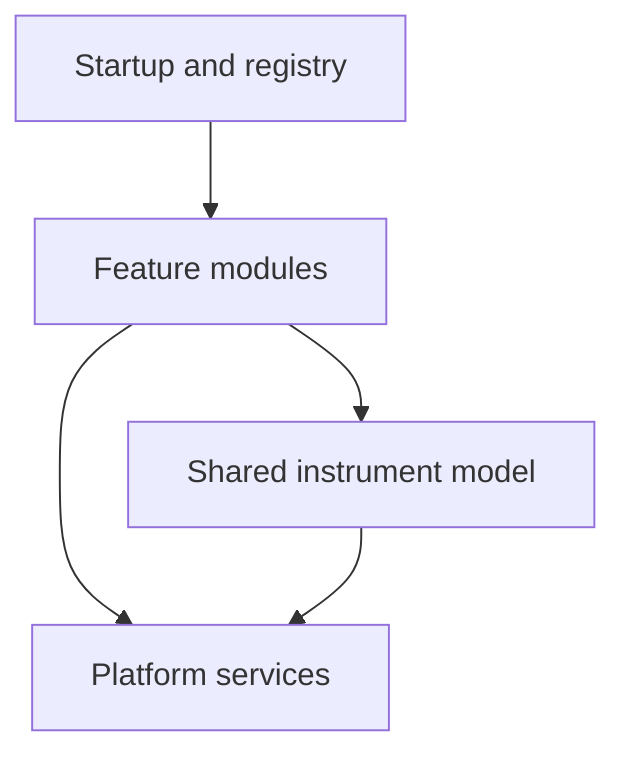

# 15. Source layout

Part of the [rs7string architecture](../ARCHITECTURE.md).


The rules are in [Code structure](../agents/code-structure.md#code-structure);
`tools/check_layout.py` checks them.

## Map of the layers

Features own their hooks, logic, settings and tests (in `tests/<name>/`). They share the string-count model and platform
services instead of reaching into each other. Startup connects the layers.



| Layer | Start here |
|---|---|
| Platform | `src/platform/`: patching, settings, logging and hooks |
| Model | `src/model/`: instrument state and chart extension |
| Feature | `src/features/<name>/`: feature-specific logic and game hooks |
| Interface | `src/overlay/` and `src/d3d/`: F9 UI and graphics hooks |
| Startup | `src/startup.cpp` and `src/registry.cpp`: wiring and registration |

## Why features share a core

Most features patch different game code and can
live in their own folder with their sites, hooks, logic, settings and tests (a vertical slice). The seven-string
features are not independent, though: they share one model of the instrument (string count, tunings, the
7-string unit that fails as a whole, [chapter 3](03-the-string-count-model.md)). That model is a layer of its own (`src/model/`), next to the
platform (`src/platform/`: patching, resolve, mid-hook, protection, log, config), so no feature duplicates it and
no feature reaches into another.

```
src/
  platform/           no game knowledge
  model/              the string-count model, no game addresses
  features/<name>/    <name>.h (public), logic (<name>.cpp, <part>.cpp), hooks*.cpp, registration.cpp, settings.cpp
  d3d/  overlay/      device hooks, F9 overlay
  startup.cpp         wires platform, model and features together: Rs7_Startup is a list of phases (config, wait
                      for the game, isolated features, resolve, bind, 7-string unit checks, patch rounds, report,
                      device worker); feature steps are the features' own Rs7<X>_Start / _Configure / _Prepare
  startup_sites.cpp   the main batch: site writers, isolated patch rounds, deferred FretGrid sites, per-site log
```

Inside a feature the logic is plain C++ over values (unit-tested natively), the hooks are thin glue between the
game's registers or memory and that logic. The site list stays one file (`sites.json`, `tools/gen_sites.py`); each
feature's hook rows are its own table (`registration.cpp`), and `src/registry.cpp` lists the tables once.

## Where each part lives

- `platform/`: patch, pattern, resolve, protect, sites, midhook (+ `midhook_wrap`, the MASM thunks), fncopy, log,
  retry, safecopy, config (ini helpers), settings (the store, no keys), uilayout, freeze, spinprobe, hooktable
  (`Rs7Hook` / `Rs7HookTable` and the lookup), isolate (the patch rounds; groups are plain integers, `Rs7Group`).
  The few remaining naked stubs live in their features ("Remaining stubs", [chapter 14](14-mid-hook-contract-and-cold-site-conversion.md#remaining-stubs)).
- `model/`: instrument (the game's instrument record and the extended-count checks), slots (string counts and slot
  ranges), tuning, stringcolour, extblock (RS7X), status (overlay status board), groups (`Rs7Feature`,
  `Rs7_Group`, the 7-string unit).
- `features/`: allocstats, arrangements, bass, chords, clite, colours, diag, diagrams, extras, fretgrid, frets,
  headstock, nextgrid, nslot, pitch, psarc, publish, scene, songend, spacing, string7, strings, testdrive, tuner,
  window. Each has its hook table(s) and settings table where it needs them; its tests are in `tests/<name>/`.
  `extras` holds the no-op hooks the public build uses for the private-only features. Every hook row lives in its feature; a group is its table's group (data references are
  Core), so `Rs7_FeatureOf` has no id or flag rules.
- App layer: `startup.cpp` / `startup_sites.cpp`, `registry.cpp` (table list, `Rs7_FindHook`, `kRs7Groups`),
  `hook_rules.cpp` (`Rs7_DisableFeature` cascade as a table, `Rs7_ShouldPatch`), `settings_tables.cpp`,
  `settings_removed.cpp`, `dinput_wrap`, `d3d/`, `overlay/`. The plain-PSARC unit gets the lookup and the groups from
  startup (`Rs7PlainHost`), so no feature includes the app layer.

## Adding a feature

Use `src/features/psarc/` as the template:

| File | Responsibility |
|---|---|
| `<name>.h` | Public interface for other code and declarations for tests |
| `<name>.cpp`, `<part>.cpp` | Feature logic, independent of registers and game addresses |
| `hooks*.cpp` | Connect game state and patch sites to the feature logic |
| `settings.cpp` | Feature settings and overlay items |
| `registration.cpp` | Feature hook table |
| `tests/<name>/` | Native tests |

<details markdown="1">
<summary><b>File-by-file details</b></summary>

| File | Contents |
|---|---|
| `<name>.h` | The public header, the only one other code includes: the startup entry, what the overlay or log reads, `extern const Rs7HookTable kRs7<Name>Hooks;` (forward-declared `struct Rs7HookTable;`). Below it the logic's declarations, for the feature's tests. |
| `<name>.cpp`, `<part>.cpp` | Logic: values in, values out. No Win32, no game addresses, no registers. |
| `hooks.cpp`, `hooks_<part>.cpp` | Glue: the stubs / mid-hook callbacks and the code that resolves and writes the sites. Reads its own ini keys. |
| `settings.cpp` | The feature's settings table: its `Rs7SetDef` rows (section, key, type, when, default, range, overlay label, help, the live `apply` and optionally `startup`) as `const Rs7SetTable kRs7<Name>Settings = {kDefs, count, Read};`, and its typed startup read (`Rs7<Name>_ReadIni`, a struct with the values and their validity for the log, kept for `Rs7<Name>_Config()`). Where it has overlay controls, its overlay items (`const Rs7UiTable kRs7<Name>Ui`, "Overlay tabs" below). |
| `registration.cpp` | The feature's `Rs7Hook` entries in an anonymous-namespace array, exported as `const Rs7HookTable kRs7<Name>Hooks = {Rs7Feature::<Group>, kHooks, count};`. |
| `tests/<name>/` | Native tests (`TEST(...)`, the test project compiles `tests/**`). |

</details>

1. Put the feature's rows into `registration.cpp` and add its table to `kTables` in `src/registry.cpp` (one line).
   `Rs7_FindHook` searches every table; `Rs7_FeatureOf` returns the table's group. Write conditions are in
   `Rs7_ShouldPatch` (`src/hook_rules.cpp`).
2. Startup calls the feature through `<name>.h` only. The feature reads its own ini keys (for example
   `Rs7Plain_StartFromIni`); its keys go into its settings table (`settings.cpp`, below), listed in
   `src/settings_tables.cpp`.
3. When you move existing code, use `git mv` and keep function names, so `scripts\compare_builds.ps1 -NoOpt` matches
   them (`-Alias` only for code that leaves an anonymous namespace for a named one), and list every difference in the
   pull request. A moved file keeps its `tools/layout_baseline.json` entry under the new path.
4. Update the paths in `tools/` (generators, `tools/tests/`), AGENTS.md and this document.
5. Gates: `scripts\format.ps1`, `build.ps1` (includes `check_layout`), pytest, `sitecheck`, `check_exports`.

## Settings

Each feature owns its settings table. `src/settings_tables.cpp` collects those tables, and `platform/settings` provides the shared store.

<details markdown="1">
<summary><b>Settings order and startup reads</b></summary>

`platform/settings` is the settings store the overlay and the pipe commands edit; it knows no key. Every
feature owns an `Rs7SetTable` (above); `src/settings_tables.cpp` lists every table once (`kRs7SettingTables`, like
`kTables` for the hooks). That list is the only central order. The list
order is the order of the keys (`Rs7Set_Def`, `Rs7Set_Save`) and of the startup reads; the release template
(`scripts\package.ps1 -TemplateOnly`, and with it `docs/release/SETTINGS.md`) orders the ini sections itself and keeps
the list order inside a section (the comment in `settings_tables.cpp` says how the list is ordered). `Rs7Set_ReadIni`
runs every table's `read` (at startup, and again in `Rs7Set_InitFromIni`); a row's `startup` hands the feature's own
validated value to the store (for example string 6's colourblind colour follows string 6's colour, the string spacing
values, the autotune clamp). The keys removed in
1.0 are in `src/settings_removed.cpp` (a table without rows whose read logs each one present), the overlay's own in
`overlay/overlay_settings.cpp`. Keys read only by their feature at startup (`[chords] diagrams7`,
...) have no row; `scripts/package.ps1` lists them for the template.

</details>

## Overlay tabs

Features declare their own overlay items in `Rs7UiTable`; the shared overlay renders them. Player-facing items appear in the default view, with the remaining controls under Advanced.

<details markdown="1">
<summary><b>Overlay data and layout details</b></summary>

Each feature also owns its part of the F9 overlay, as data: an `Rs7UiTable` (`platform/uilayout.h`)
next to its settings table in `settings.cpp`, exported as `kRs7<Name>Ui`. Its items say which of its settings show, in
which tab, in which order, under which section titles, and its live rows (a `Row` or an `OnOff` with a small reader
that formats the feature's counters). `src/settings_tables.cpp` lists every table once (`kRs7UiTables`); a tab shows
its items in list order. `overlay/ui.cpp` keeps the generic part: the tab bar, a setting's control from its
`Rs7SetDef` (type, label, help, badges), the status board (build, sites, song, overlay) with the features' `Status`
items under "features", and the log. The layout is data, not per-feature ImGui functions, so features do
not include ImGui and the layout has native tests (`tests/test_uilayout.cpp` pins every tab's items). A setting without
an item (`[window] console_quickedit_off`, ...) has no control. The item's tab is also the player/advanced
split: `Rs7UiTab::Player` items (`Rs7UiPlayer(id, label, hint)`, a plain label and a one-line hint the test checks for
key names and developer terms) form the default view; everything in the technical tabs is under the "Advanced" tab.
The split is data in the feature's table, not a list in `ui.cpp`. Each `Rs7UiPlayerSection(title, tabLabel)` in the Player items is one tab of the
overlay's single tab bar (`Rs7Ui_PlayerTabs`), Advanced is the last tab, and a hint is a `(?)` tooltip.

Both projects compile `src/features/**` into one object folder per source folder (`ObjectFileName`), because every
feature has a `hooks.cpp` and a `registration.cpp`.

</details>

## Inline assembly

A patch site needs a few instructions that save the game's registers and enter C++; MSVC
x86 C++ cannot express that, so that code exists once (the mid-hook thunks, MASM in
`src/platform/midhook_thunks.asm`, [chapter 14](14-mid-hook-contract-and-cold-site-conversion.md)) or comes from a
generator; it is not written per site. The mid-hook covers:

- plain sites, with a relocator that also accepts the operand-size prefix `66` and the `INC` / `DEC r/m8` forms;
- call sites, with the callback before or after the callee (`Rs7Mid::Call::Before` / `After`);
- wrappers that see the callee's arguments (`Rs7Mid::Call::Wrap`, `src/platform/midhook_wrap.cpp`);
- hot sites, through the light mode (about 25 ns instead of 150 ns per hit, no floating-point save, all GPRs kept so
  the `Context` stays identical) and the sse mode. Measure one hot site in game before converting hot sites.

The naked stubs that remain need a custom calling convention or call the game with register arguments.

Every conversion keeps its emulator comparison against the stock bytes.
