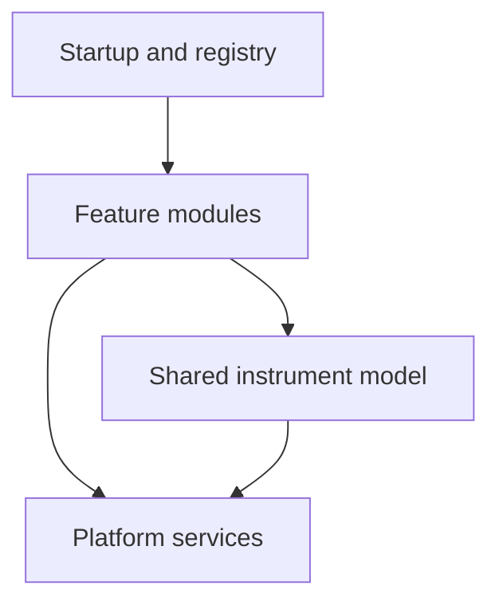

# 15. Source layout

Part of the [RS Extended Range architecture](../ARCHITECTURE.md).


The layout rules are in [Code structure](../agents/code-structure.md#code-structure), and
`tools/check_layout.py` checks them.

## Map of the layers

Features own their hooks, logic, settings and tests (in `tests/<name>/`). Instead of reaching into each
other, they share the string-count model and the platform services. Startup connects the layers.



| Layer | Start here |
|---|---|
| Platform | `src/platform/`: patching, settings, logging and hooks |
| Model | `src/model/`: instrument state and chart extension |
| Feature | `src/features/<name>/`: feature-specific logic and game hooks |
| Interface | `src/overlay/` and `src/d3d/`: F9 UI and graphics hooks |
| Startup | `src/startup.cpp` and `src/registry.cpp`: wiring and registration |

## Why features share a core

Most features patch different game code. Each of them can live in its own folder with its sites, hooks,
logic, settings and tests, as a vertical slice. The seven-string features are not independent, though. They
share one model of the instrument with the string count, the tunings and the 7-string unit that fails as a
whole ([chapter 3](03-the-string-count-model.md)). That model is a layer of its own (`src/model/`), next to
the platform (`src/platform/`: patching, resolve, mid-hook, protection, log, config), so no feature
duplicates it.

A feature may include another feature's public header (`features/<name>/<name>.h`), but never its internal
headers. `tools/check_layout.py` checks this.

```
src/
  platform/           no game knowledge
  model/              the string-count model, no game addresses
  features/<name>/    <name>.h (public), logic (<name>.cpp, <part>.cpp), hooks*.cpp, registration.cpp, settings.cpp
  d3d/  overlay/      device hooks, F9 overlay
  startup.cpp         wires platform, model and features together: Rsxr_Startup is a list of phases (config, wait
                      for the game, isolated features, resolve, bind, 7-string unit checks, patch rounds, report,
                      device worker); feature steps are the features' own Rsxr<X>_Start / _Configure / _Prepare
  startup_sites.cpp   the main batch: site writers, isolated patch rounds, deferred FretGrid sites, per-site log
```

Inside a feature, the logic is plain C++ over values, and it is unit-tested natively. The hooks are thin glue
between the game's registers or memory and that logic. The site list stays in one file (`sites.json`,
`tools/gen_sites.py`). Each feature's hook rows form its own table (`registration.cpp`), and
`src/registry.cpp` lists the tables once.

## Where each part lives

- `platform/`: patch, pattern, resolve, protect, sites, midhook (+ `midhook_wrap`, the MASM thunks), fncopy,
  log, retry, safecopy, config (ini helpers), settings (the store, no keys), uilayout, freeze, spinprobe,
  hooktable (`RsxrHook` / `RsxrHookTable` and the lookup), isolate (the patch rounds; groups are plain
  integers, `RsxrGroup`). The few remaining naked stubs live in their features ("Remaining stubs",
  [chapter 14](14-mid-hook-contract-and-cold-site-conversion.md#remaining-stubs)).
- `model/`: instrument (the game's instrument record and the extended-count checks), slots (string counts
  and slot ranges), tuning, stringcolour, extblock (extension block), nativesng and nativemanifest (the
  converters of the [native format](../NATIVE-FORMAT.md)), status (overlay status board), groups
  (`RsxrFeature`, `Rsxr_Group`, the 7-string unit).
- `features/`: allocstats, arrangements, bass, chords, clite, colours, diag, diagrams, extras, fretgrid,
  frets, headstock, menuload, native, nextgrid, nslot, pitch, psarc, publish, scene, songend, spacing,
  string7, strings, testdrive, tuner, window. Each feature has its hook table(s) and settings table where
  it needs them. Its tests are in `tests/<name>/`. `extras` holds the no-op hooks that the public build
  uses for the private-only features. Every hook row lives in its feature, and a row's group is its
  table's group (data references are Core). So `Rsxr_FeatureOf` has no id or flag rules.
- App layer: `startup.cpp` / `startup_sites.cpp`, `registry.cpp` (table list, `Rsxr_FindHook`,
  `kRsxrGroups`), `hook_rules.cpp` (`Rsxr_DisableFeature` cascade as a table, `Rsxr_ShouldPatch`),
  `settings_tables.cpp`, `settings_removed.cpp`, `dinput_wrap`, `d3d/`, `overlay/`. The plain-PSARC unit
  gets the lookup and the groups from startup (`RsxrPlainHost`), so no feature includes the app layer.

## Adding a feature

Use `src/features/psarc/` as the template:

| File | Responsibility |
|---|---|
| `<name>.h` | Public interface for other code and declarations for tests |
| `<name>.cpp`, `<part>.cpp` | Feature logic, independent of registers and game addresses |
| `hooks*.cpp` | Connect game state and patch sites to the feature logic |
| `settings.cpp` | Feature settings and overlay items |
| `registration.cpp` | Feature hook table |
| `tests/<name>/` | Native tests |

<details markdown="1">
<summary><b>File-by-file details</b></summary>

| File | Contents |
|---|---|
| `<name>.h` | The public header, the only one other code includes: the startup entry, what the overlay or log reads, `extern const RsxrHookTable kRsxr<Name>Hooks;` (forward-declared `struct RsxrHookTable;`). Below it the logic's declarations, for the feature's tests. |
| `<name>.cpp`, `<part>.cpp` | Logic: values in, values out. No Win32, no game addresses, no registers. |
| `hooks.cpp`, `hooks_<part>.cpp` | Glue: the stubs / mid-hook callbacks and the code that resolves and writes the sites. Reads its own ini keys. |
| `settings.cpp` | The feature's settings table: its `RsxrSetDef` rows (section, key, type, when, default, range, overlay label, help, the live `apply` and optionally `startup`) as `const RsxrSetTable kRsxr<Name>Settings = {kDefs, count, Read};`, and its typed startup read (`Rsxr<Name>_ReadIni`, a struct with the values and their validity for the log, kept for `Rsxr<Name>_Config()`). Where it has overlay controls, its overlay items (`const RsxrUiTable kRsxr<Name>Ui`, "Overlay tabs" below). |
| `registration.cpp` | The feature's `RsxrHook` entries in an anonymous-namespace array, exported as `const RsxrHookTable kRsxr<Name>Hooks = {RsxrFeature::<Group>, kHooks, count};`. |
| `tests/<name>/` | Native tests (`TEST(...)`, the test project compiles `tests/**`). |

</details>

1. Put the feature's rows into `registration.cpp`, and add its table to `kTables` in `src/registry.cpp`
   (one line). `Rsxr_FindHook` searches every table, and `Rsxr_FeatureOf` returns the table's group. The
   write conditions are in `Rsxr_ShouldPatch` (`src/hook_rules.cpp`).
2. Make startup call the feature through `<name>.h` only. The feature reads its own ini keys (for example
   `RsxrPlain_StartFromIni`). Its keys go into its settings table (`settings.cpp`, below), which is listed
   in `src/settings_tables.cpp`.
3. When you move existing code, use `git mv` and keep the function names, so that
   `scripts\compare_builds.ps1 -NoOpt` matches them. Use `-Alias` only for code that leaves an anonymous
   namespace for a named one. List every difference in the pull request. A moved file keeps its
   `tools/layout_baseline.json` entry under the new path.
4. Update the paths in `tools/` (generators, `tools/tests/`), AGENTS.md and this document.
5. Run the gates: `scripts\format.ps1`, `build.ps1` (includes `check_layout`), pytest, `sitecheck`,
   `check_exports`.

## Settings

Each feature owns its settings table. `src/settings_tables.cpp` collects those tables, and `platform/settings` provides the shared store.

<details markdown="1">
<summary><b>Settings order and startup reads</b></summary>

`platform/settings` is the settings store that the overlay and the pipe commands edit. It knows no key.
Every feature owns an `RsxrSetTable` (above). `src/settings_tables.cpp` lists every table once
(`kRsxrSettingTables`, like `kTables` for the hooks). That list is the only central order.

The list order is the order of the keys (`RsxrSet_Def`, `RsxrSet_Save`) and of the startup reads. The
release template (`scripts\package.ps1 -TemplateOnly`, and with it `docs/release/SETTINGS.md`) orders the
ini sections itself, and keeps the list order inside a section. The comment in `settings_tables.cpp`
explains how the list is ordered.

`RsxrSet_ReadIni` runs every table's `read`, at startup and again in `RsxrSet_InitFromIni`. A row's
`startup` hands the feature's own validated value to the store. Examples are string 6's colorblind
color (which follows string 6's color), the string spacing values and the autotune clamp.

The keys removed in 1.0 are in `src/settings_removed.cpp`. This is a table without rows, and its read
logs each removed key that is present. The overlay's own keys are in `overlay/overlay_settings.cpp`. Keys
that only their feature reads at startup (`[chords] diagrams7`, ...) have no row. `scripts/package.ps1`
lists them for the template.

</details>

## Overlay tabs

Features declare their own overlay items in `RsxrUiTable`, and the shared overlay renders them. Player-facing items appear in the default view. The remaining controls are under Advanced.

<details markdown="1">
<summary><b>Overlay data and layout details</b></summary>

Each feature also owns its part of the F9 overlay, as data. This is an `RsxrUiTable`
(`platform/uilayout.h`) next to its settings table in `settings.cpp`, exported as `kRsxr<Name>Ui`. Its
items say which of its settings show, in which tab, in which order and under which section titles. They
also define its live rows. A live row is a `Row` or an `OnOff` with a small reader that formats the feature's counters.
`src/settings_tables.cpp` lists every table once (`kRsxrUiTables`), and a tab shows its items in list
order.

`overlay/ui.cpp` keeps the generic part:

- the tab bar
- a setting's control, built from its `RsxrSetDef` (type, label, help, badges)
- the status board (build, sites, song, overlay), with the features' `Status` items under "features"
- the log

The layout is data, not per-feature ImGui functions. So features do not include ImGui, and the layout has
native tests (`tests/test_uilayout.cpp` pins every tab's items). A setting without an item
(`[window] console_quickedit_off`, ...) has no control.

The item's tab also decides the player/advanced split. `RsxrUiTab::Player` items form the default view.
They are created with `RsxrUiPlayer(id, label, hint)`, which takes a plain label and a one-line hint. The
test checks the hint for key names and developer terms. Everything in the technical tabs is under the "Advanced" tab.
The split is data in the feature's table, not a list in `ui.cpp`. Each `RsxrUiPlayerSection(title, tabLabel)`
in the Player items is one tab of the overlay's single tab bar (`RsxrUi_PlayerTabs`). Advanced is the last
tab, and a hint is a `(?)` tooltip.

Both projects compile `src/features/**` into one object folder per source folder (`ObjectFileName`),
because every feature has a `hooks.cpp` and a `registration.cpp`.

</details>

## Inline assembly

A patch site needs a few instructions that save the game's registers and enter C++. MSVC x86 C++ cannot
express that. So that code exists only once (the mid-hook thunks, MASM in
`src/platform/midhook_thunks.asm`, [chapter 14](14-mid-hook-contract-and-cold-site-conversion.md)) or
comes from a generator. It is not written per site. The mid-hook covers:

- plain sites, with a relocator that also accepts the operand-size prefix `66` and the `INC` / `DEC r/m8`
  forms;
- call sites, with the callback before or after the callee (`RsxrMid::Call::Before` / `After`);
- wrappers that see the callee's arguments (`RsxrMid::Call::Wrap`, `src/platform/midhook_wrap.cpp`);
- hot sites, through the light mode and the sse mode. The light mode costs about 50 ns instead of 240 ns
  per hit with the fault guard. It has no floating-point save and keeps all GPRs, so the `Context` stays
  identical. Measure one hot site in game before you convert hot sites.

The naked stubs that remain need a custom calling convention or call the game with register arguments.

Every conversion keeps its emulator comparison against the stock bytes.
