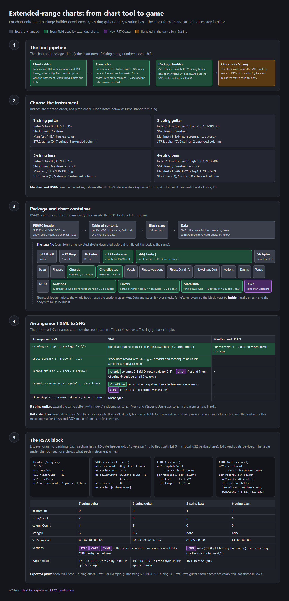

# Extended-range support in chart tools

**How chart editors and package builders support extended-range arrangements in rs7string.**

[Contributing](../../CONTRIBUTING.md) · [Development](../DEVELOPMENT.md) · [Architecture](../ARCHITECTURE.md) · [RS7X spec](RS7X-SPEC.md) · **Chart tools** · [Releasing](../RELEASING.md) · [Agents](../../AGENTS.md)

| | |
|---|---|
| Audience | Developers of chart editors (for example EOF) and package builders (for example DLC Builder, Rocksmith2014.NET) |
| Status | SNG, manifest and package rules: stable since rs7string 1.0 ([RS7X spec](RS7X-SPEC.md)). Arrangement XML names: **proposal**, see [section 3](#3-arrangement-xml-proposal) |
| Byte-level reference | [RS7X-SPEC.md](RS7X-SPEC.md) |
| For chart authors | [CHARTING.md](CHARTING.md) |

## Contents

1. [Overview](#1-overview)
2. [The rules in short](#2-the-rules-in-short)
3. [Arrangement XML (proposal)](#3-arrangement-xml-proposal)
4. [XML to SNG](#4-xml-to-sng)
5. [Manifest and HSAN](#5-manifest-and-hsan)
6. [Package](#6-package)
7. [Reading packages back](#7-reading-packages-back)
8. [Checklists](#8-checklists): [chart editor](#chart-editor-xml-export), [converter and package builder](#converter-and-package-builder)
9. [Worked example](#9-worked-example)
10. [Testing](#10-testing)
11. [Open points](#11-open-points)

## 1. Overview

> [!TIP]
> The graphic below is detailed. Open it [full size](img/chart-format.png), or as a
> [page with selectable text](img/chart-format.html).



All four instruments use Rocksmith 2014's existing formats. The stock string indices stay the same;
extra guitar chord columns go in the RS7X extension. Bass uses the stock six slots for notes and
an RS7X marker to identify the arrangement. See the [RS7X specification](RS7X-SPEC.md) for the
complete writer rules.

## 2. The rules in short

**Seven-string guitar example.** Sections 2 to 9 spell out the seven-string guitar; the other instruments differ
only in these points:

| Instrument | Extra string indices | Tuning entries | Manifest and HSAN keys | Chord data in RS7X |
|---|---|---|---|---|
| 7-string guitar | 6 (low B) | 7 | `Rs7String6` | `CHDT`, `CHNT`, one column |
| 8-string guitar | 6 (low B), 7 (low F#) | 8 | `Rs7String6`, `Rs7String7` | `CHDT`, `CHNT`, two columns |
| 5-string bass | 4 (low B) | 6, as stock | `Rs7String4` | none, `STRS` only |
| 6-string bass | 4 (low B), 5 (high C) | 6, as stock | `Rs7String4`, `Rs7String5` | none, `STRS` only |

The [charting guide](CHARTING.md#format-rules) has the rules for all four, and the
[RS7X specification](RS7X-SPEC.md) the byte layout.

**Seven-string rules in short:**

| What | Rule |
|---|---|
| Arrangement | A normal guitar Lead or Rhythm arrangement. There is no new arrangement type. Four-string bass stays unchanged; five- and six-string bass: [section 3](#3-arrangement-xml-proposal). |
| String numbers | 0 = low E ... 5 = high e, as stock. The low B is **6**. Never shift the stock numbers. |
| Pitch | Open string 6 is MIDI **35** (B1) + tuning[6]. Fretted: add the fret. The same formula as the stock strings. |
| Tuning | **Seven** tuning entries, matching the instrument count selected by the manifest keys. B standard is `0` on every string; Drop A is `-2` on string 6 only. |
| Single notes | Stock note records with `string` = 6. |
| Chords | Stock chord columns 0-5 as usual, plus string 6 in the RS7X block (`CHDT`, `CHNT`). |
| Manifest and HSAN | Add `Rs7String6` after `string5`. **Never `string6`**: it crashes the stock song list. |
| Six-string charts | Unchanged. Byte for byte what the tool writes today, no RS7X block. |

The manifest keys select the built instrument before the song loads. The SNG tuning must match that count;
seven SNG entries alone cannot build a seven-string guitar. A mismatch leaves the detector at stock width and
logs `song detector: not widened: the guitar was built with another string count (song, guitar)`.

## 3. Arrangement XML (proposal)

EOF writes Rocksmith arrangement XML and DLC Builder converts it, so both need the same names. The
proposal continues the stock pattern with index 6. A tool that knows these names writes and reads them;
nothing else in the XML changes.

| Element | Stock | Seven strings |
|---|---|---|
| `<tuning>` | `string0` ... `string5` | add **`string6`**. Its presence marks a seven-string arrangement. |
| `<note>` | `string="0"` ... `"5"` | `string="6"` |
| `<chordTemplate>` | `fret0` ... `fret5`, `finger0` ... `finger5` | add **`fret6`** and **`finger6`**. Absent means `-1` (not in the chord). |
| `<chordNote>` inside `<chord>` | `string="0"` ... `"5"` | `string="6"`, with the same attributes as any other chord note |
| Everything else | | unchanged: `<anchor>`, `<handShape>`, phrases, sections, beats, events, tones |

```xml
<!-- B standard: the open seventh string is B1, so B (string 6 open) + F# (string 0 fret 2) is B5 -->
<tuning string0="0" string1="0" string2="0" string3="0" string4="0" string5="0" string6="0" />

<chordTemplate chordName="B5" displayName="B5" fret0="2" fret1="-1" fret2="-1" fret3="-1" fret4="-1"
               fret5="-1" fret6="0" finger0="1" finger1="-1" finger2="-1" finger3="-1" finger4="-1"
               finger5="-1" finger6="-1" />
```

> [!IMPORTANT]
> `string6` is fine in the XML. It must **not** be copied into the manifest or the HSAN under that name
> (see [section 5](#5-manifest-and-hsan)). A tool that copies the XML tuning attributes into the
> manifest by name has to map `string6` to `Rs7String6`.

Validation for an XML reader:

- `string="6"`, `fret6` or `finger6` without a `string6` tuning value is an error.
- A chord template must keep **at least one** stock column (0-5). A "chord" that sounds only on string 6
  is a single note.
- Text that ends up in the package (chord names, section and phrase names, keys) is printable ASCII.
  Chord names: at most 30 characters.

Eight strings follow the same pattern (`string7`, `fret7`, `finger7`, string index 7 = F#1, MIDI 30).

Five- and six-string bass use the bass arrangement and the next free indices, in the package's order: 0-3 = E A D
G as stock, **4** = the low B (B0, MIDI 23), **5** = the high C (C3, MIDI 48). The XML uses the same numbers as the
SNG; never number the low B 0 and shift the stock strings. A stock bass XML already has `string4` and `string5`
in `<tuning>` (unused, `0`), so their presence cannot mark the bass: a tool decides five or six strings from its own
project and writes the matching manifest keys and RS7X block ([RS7X spec section 2.3](RS7X-SPEC.md#23-strs---strings-version-1-critical-must-be-the-first-section)).

Why the extra strings are numbered after the stock ones, not by pitch (low B = 0):

- The game gives each string number a fixed meaning: its open note (0 = E), colour, string gauge, lane, peg and
  tuner position. A low B at 0 would be drawn, tuned and named as the E string.
- The stock strings keep their numbers in every chart: a 4-, 5- and 6-string chart of a song number the E string 0,
  and tools that know only stock bass read strings 0-3 correctly.
- The seven- and eight-string guitar work the same way (low B = 6, low F# = 7).

An editor can still show and store the strings in pitch order (B E A D G C); it converts only when it writes the XML
and the SNG.

## 4. XML to SNG

**Seven-string guitar example.** The converter keeps its stock code path and changes these steps. Byte layouts
are in the [RS7X spec](RS7X-SPEC.md). For eight strings add index 7 in the same places; for bass see the table in
[section 2](#2-the-rules-in-short).

1. **Range checks.** Allow string 6 when the arrangement has a `string6` tuning value.
2. **MetaData tuning.** Write **seven** `i16` entries (`i32` count 7). A fixed six-entry array is the most
   common thing to change.
3. **Notes.** A note on string 6 is a stock note record with `string` = 6. Masks, sustain, slides, bends,
   vibrato and harmonics are computed as for any other string.
4. **Section string masks.** Set bit 6 of `stringMask[difficulty]` in every section and difficulty that has
   a note or chord on string 6 (bit 7 for string 7; bass: bits 4 and 5). The game also adds missing bits
   when the song loads, so a missing bit costs nothing; write exact masks all the same.
5. **Chord templates.** Write the six stock columns as usual: frets, fingers and MIDI `notes[]` for
   strings 0-5, `-1` for unused columns. Never put string 6's pitch into a free stock column. Leave the last
   byte of the 32-byte name at 0. String 6's fret and finger go into `CHDT`, one record per template in the
   same order. **Deduplicate on all seven columns**: two chords that differ only on string 6 are two
   templates.
6. **ChordNotes.** Write a record when any string of the chord, stock or string 6, has technique data
   **or is open**. Set the note's `chordNotesId` and its `CHORD_NOTES` bit (`0x1000000`). String 6's mask,
   slides, vibrato and bends go into the record's `CHNT` entry; an open string 6 needs the `OPEN` bit
   (`0x4`) there, or the game draws it as a fretted gem. Deduplicate on stock and string 6 data together.
   A string that is not in the chord or has nothing to store gets the empty entry
   `00 00 00 00 ff ff 00 00 00`.
7. **Double stops.** Count string 6 too: a chord with exactly two sounding strings gets `DOUBLE_STOP`
   (`0x02000000`).
8. **Generated difficulty levels.** String 6 notes and chords take part like any other string; the
   `CHDT` and `CHNT` records follow the template and ChordNotes tables, which are shared by all levels.
9. **RS7X block.** Append it right after MetaData, inside the uncompressed body, with `STRS`, `CHDT` and
   `CHNT` in this order, even when a count is 0. Then compress the whole body and write the body size
   **including** the block. Data after the zlib stream is not read.

## 5. Manifest and HSAN

In the arrangement manifest JSON and in the HSAN, every `Tuning` object keeps `string0` to `string5` and
gets **`Rs7String6`** (spelt exactly like this) with the same value as the SNG's seventh entry:

```json
"Tuning": {
  "string0": 0, "string1": 0, "string2": 0,
  "string3": 0, "string4": 0, "string5": 0,
  "Rs7String6": -2
}
```

> [!WARNING]
> The game's song-list reader stores every `string<N>` key in room for six values. A `string6` key writes
> past it and crashes the stock game while it loads the song list. The stock game ignores
> `Rs7String6`; rs7string reads it for the song list, the tuner and the tuning name.

An eight-string guitar also gets `Rs7String7` with the SNG's eighth entry. Bass is different: the offsets stay in
`string4` (low B) and `string5` (high C), and `Rs7String4` (five strings) and `Rs7String5` (six strings) only mark
the string count. Write them with the same values as `string4` and `string5`. The charting guide has
[an example of each](CHARTING.md#the-tuning-object-key-by-key).

Other manifest fields (arrangement properties, tones, the tuning name text) need no change.

## 6. Package

- rs7string's own test packages are **plain PSARC**: an unencrypted table of contents (archive
  flags without `0x4`) and SNG flags `1` (zlib only), with zeroed IV and signature slots. rs7string loads
  them itself with `[psarc] plain=1`; players also need a CDLC enabler.
- Encrypted packages work too. The RS7X block sits inside the SNG body, and the game decrypts an encrypted
  SNG before it inflates the body, so the block comes through encryption unchanged.
- File names and DLC keys: printable ASCII.

## 7. Reading packages back

A tool that imports packages (SNG to XML) should read the block, so a seven-string package opens with its
seventh string:

1. Read the stock sections as usual. If the body has bytes left after MetaData, check them against the
   validation rules in [RS7X spec section 3](RS7X-SPEC.md#3-validation-rules). On any failure, treat the
   block as absent.
2. With a valid block: `CHDT` gives `fret6` and `finger6` for each template, `CHNT` gives the chord note
   data of string 6 for each ChordNotes record, and seven tuning entries give `string6`.
3. Without a block, seven tuning entries and a non-zero last name byte in a chord template: an older
   rs7string package. That byte holds string 6's chord column (see [RS7X spec section 1](RS7X-SPEC.md#1-why-a-block-and-where-it-goes)).
4. Otherwise the arrangement is six strings.

## 8. Checklists

### Chart editor (XML export)

1. The editor allows seven strings on guitar arrangements (string index 6).
2. `<tuning>` gets `string6`; `<note>` and `<chordNote>` use `string="6"`; `<chordTemplate>` gets
   `fret6` and `finger6`.
3. Every chord template keeps at least one stock string; a one-note chord on string 6 is exported as a
   note.
4. Six-string arrangements export exactly as before.
5. Import of such XML restores the seventh string.

### Converter and package builder

1. Accept string index 6 when the XML has `string6`.
2. MetaData tuning: seven entries.
3. Section string masks: bit 6.
4. Chord templates: stock projection + `CHDT`, deduplicated on seven columns, name byte 31 = 0.
5. ChordNotes: a record also for open or technique-carrying string 6; `CHNT` entry; `OPEN` bit for an open
   string 6.
6. Double stops counted over seven strings.
7. RS7X block after MetaData, inside the zlib body; the body size includes it. No block for six strings.
8. Manifest and HSAN: `Rs7String6`, never `string6`.
9. Import: parse the block ([section 7](#7-reading-packages-back)).

## 9. Worked example

**Seven-string guitar example:** B standard, two chord templates and one sustained chord. This is the first example in
[RS7X spec section 7](RS7X-SPEC.md#7-examples), written as XML.

```xml
<tuning string0="0" string1="0" string2="0" string3="0" string4="0" string5="0" string6="0" />
<chordTemplates count="2">
  <!-- 0: C#5 = string 6 fret 2 (index finger) + string 0 fret 4 (ring finger) -->
  <chordTemplate chordName="C#5" displayName="C#5" fret0="4" fret1="-1" fret2="-1" fret3="-1" fret4="-1"
                 fret5="-1" fret6="2" finger0="3" finger1="-1" finger2="-1" finger3="-1" finger4="-1"
                 finger5="-1" finger6="1" />
  <!-- 1: F#5 = string 0 fret 2 + string 1 fret 4, no string 6 -->
  <chordTemplate chordName="F#5" displayName="F#5" fret0="2" fret1="4" fret2="-1" fret3="-1" fret4="-1"
                 fret5="-1" finger0="1" finger1="3" finger2="-1" finger3="-1" finger4="-1" finger5="-1" />
</chordTemplates>
...
<chord time="2.000" chordId="0">
  <chordNote time="2.000" string="0" fret="4" sustain="1.000" />
  <chordNote time="2.000" string="6" fret="2" sustain="1.000" />
</chord>
<chord time="4.000" chordId="1" />
```

Expected SNG data:

| Item | Value |
|---|---|
| MetaData tuning | 7 entries, all 0 |
| Template 0 stock columns | frets `4 -1 -1 -1 -1 -1`, fingers `3 -1 -1 -1 -1 -1`, notes `44 -1 -1 -1 -1 -1` |
| Template 1 stock columns | frets `2 4 -1 -1 -1 -1`, fingers `1 3 -1 -1 -1 -1`, notes `42 49 -1 -1 -1 -1` |
| ChordNotes | one record, for the sustained chord at 2.0 s; string 6 entry: mask `0x2000` (sustain) |
| Pitch of string 6 in template 0 | 35 + 0 + 2 = 37 (C#2): computed, not stored |

Expected RS7X block (78 bytes):

    52 53 37 58  01 00  10 00  4e 00 00 00  03 00 00 00     RS7X, v1, header 16, block 78, 3 sections
    53 54 52 53  01 00  01 00  05 00 00 00                  STRS v1 critical, 5 bytes
      00 07 01 00 06                                        guitar, 7 strings, 1 column, -, string 6
    43 48 44 54  01 00  01 00  08 00 00 00                  CHDT v1 critical, 8 bytes
      02 00 00 00                                           2 templates
      02 01                                                 template 0: fret 2, finger 1
      ff ff                                                 template 1: -1, -1
    43 48 4e 54  01 00  00 00  0d 00 00 00                  CHNT v1, 13 bytes
      01 00 00 00                                           1 record
      00 20 00 00  ff  ff  00 00  00                        mask 0x2000 (sustain), no slide, no vibrato, 0 bends

## 10. Testing

1. Build a package and compare it with the rules above. For each SNG check: seven tuning entries,
   string 6 notes, string mask bit 6, template and ChordNotes counts equal to the `CHDT` and `CHNT`
   counts, and a body size that includes the block. The maintainer's rs7chart tool (`rs7chart dump`)
   validates all of this; it will be published later.
2. Keep a six-string control export and check that it is unchanged.
3. In the game with rs7string (see [CHARTING.md](CHARTING.md#test-a-chart)): the song list shows the
   seven-string tuning, and `rs7string.log` has one `extblock: SNG ...` line per loaded chart that reports
   the block as read, not ignored. F9 **Advanced > Status** shows seven-string mode.

## 11. Open points

- **The XML names are a proposal.** They become final once the EOF and DLC Builder maintainers agree on
  them; issues and pull requests are welcome.
- Five- and six-string bass in the XML: there is no stock place for the string count yet (see [section 3](#3-arrangement-xml-proposal)).
