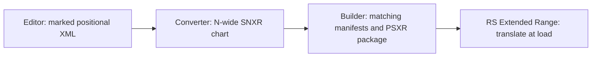

# Extended-range support in chart tools

**How chart editors and package builders support extended-range arrangements in RS Extended Range.**

[Charting](CHARTING.md) · **Chart tools** · [Native format](NATIVE-FORMAT.md) · [Install](INSTALL.md)

| | |
|---|---|
| Audience | Authors of chart editors, XML converters and package builders |
| Format | Native format, version 1. It is the only supported extended format. |
| Byte-level reference | [Native format specification](NATIVE-FORMAT.md) |
| For chart authors | [Charting guide](CHARTING.md). DotCharter's **RS Extended Range** export writes this format. |

## Contents

1. [Overview](#1-overview)
2. [The rules in short](#2-the-rules-in-short)
3. [Arrangement XML](#3-arrangement-xml)
4. [XML to SNG](#4-xml-to-sng)
5. [Manifest and HSAN](#5-manifest-and-hsan)
6. [Package](#6-package)
7. [Reading packages back](#7-reading-packages-back)
8. [Checklists](#8-checklists): [chart editor](#chart-editor-xml-export), [converter and package builder](#converter-and-package-builder)
9. [Worked example](#9-worked-example)
10. [Testing](#10-testing)
11. [Open points](#11-open-points)

## 1. Overview

> [!TIP]
> Open the detailed [pipeline diagram with selectable text](img/chart-format.html).



An extended arrangement uses one string order, **thickest first**, all the way from the editor to the package.
The editor writes marked XML, and the converter turns it into an N-wide chart. The package builder then writes
matching manifest entries and a native package. RS Extended Range translates the package when it loads it.

Each arrangement chooses its own format. Stock six-string guitar and four-string bass arrangements
keep their normal XML, manifest entries and chart bytes, even when they share a package with extended
arrangements. Such a package is called a mixed package.

## 2. The rules in short

| Instrument | Standard notes in index order, starting at 0 | N |
|---|---|---|
| 7-string guitar | B E A D G B high E | 7 |
| 8-string guitar | F# B E A D G B high E | 8 |
| 5-string bass | B E A D G | 5 |
| 6-string bass | B E A D G high C | 6 |

Indices follow the string's position, even when an alternate tuning makes the pitches cross. The pitch of a note is
`standard open MIDI note + tuning offset + fret`. The [open-note table](NATIVE-FORMAT.md#string-numbering) lists
the standard open notes.

| Part | Writer rule |
|---|---|
| Arrangement | Use the existing Lead, Rhythm or Bass arrangement type. |
| XML | `<tuning extendedRange="1" strings="N" ...>`. All tuning, note and chord indices are positional. |
| Chart | `SNXR` header, N-wide chord arrays, positional note indices and section bits, N tuning entries, then zero padding. |
| Manifest and HSAN | `"ExtendedRange": {"Version": 1}` in each extended arrangement's `Attributes`. `Tuning` has exactly N positional keys. |
| Package | Plain PSARC, `PSXR` magic and `<name>_rsxr_p.psarc` if any arrangement is extended. Otherwise stock `PSAR` and `<name>_p.psarc`. |

The instrument, string count and tuning must agree across the XML, chart, manifest JSON and HSAN. Do not write a
trailing extension block or separate extra-string tuning keys. The byte layouts are defined in the
[native specification](NATIVE-FORMAT.md#charts).

## 3. Arrangement XML

These XML rules are fixed for version 1. Read the full
[XML specification](NATIVE-FORMAT.md#arrangement-xml) when you implement import or export.

| Element | Extended arrangement |
|---|---|
| `<tuning>` | Add `extendedRange="1"` and `strings="N"`, and write positional tuning offsets. Include at least `string0` through `string5`, with unused values set to `0`, plus the higher attributes needed by guitar. |
| `<note>` | `string="i"` uses the positional index, 0 through N-1. |
| `<chordTemplate>` | `fret{i}` and `finger{i}` refer to the same positional strings. |
| `<chordNote>` | `string="i"` uses the same index as the template column and tuning attribute. |
| Other elements | Keep stock anchors, hand shapes, phrases, sections, beats, events and tones. |

For a seven-string guitar in B standard:

```xml
<tuning extendedRange="1" strings="7" string0="0" string1="0" string2="0" string3="0" string4="0" string5="0" string6="0" />
```

For a five-string bass, the XML still includes the unused `string5="0"`. The manifest and chart each have
only five tuning entries. The marker and `strings` select the string count. Having a tuning attribute doesn't change it.

Reject an unknown marker version. Read a file without the marker as stock. In that case, `strings` and tuning
attributes above `string5` do not enable extended mode, and notes beyond the stock instrument's string range
are errors.

## 4. XML to SNG

Keep the stock conversion path for stock arrangements. For an extended arrangement:

1. Validate the marker, instrument, count and string indices before conversion.
2. Write the native header specified under [Charts](NATIVE-FORMAT.md#charts), with matching instrument and N.
3. Write N tuning entries in MetaData, in positional order, including on five-string bass.
4. Keep note indices positional. Apply the stock techniques, sustains, slides, bends, vibrato and harmonics
   to every string.
5. Use bit i for string i in each section's string mask, including strings used in chords.
6. Write N entries in each chord-template array for frets, fingers and notes. Use the stock unused values for
   strings outside the chord. Deduplicate using all N columns.
7. Write N entries in each per-string ChordNotes array. Preserve stock open-string and technique flags,
   chord-note references and double-stop handling across all sounding strings. Deduplicate across all N strings.
8. Include every string when generating difficulty levels and their shared chord tables.
9. Append the zero [padding](NATIVE-FORMAT.md#padding) after MetaData, compress header, body and padding
   together, and include all of them in the wrapper's uncompressed size.

The record layouts, sizes and padding formula are specified in one place only, the
[native format](NATIVE-FORMAT.md#charts). Do not split chord data into separate stock and extra-string tables.

## 5. Manifest and HSAN

Write the marker and positional tuning inside `Attributes` in **both** the arrangement JSON and its HSAN entry.
For a five-string bass with its low B tuned down to A:

```json
"ArrangementName": "Bass",
"ExtendedRange": { "Version": 1 },
"Tuning": {
  "string0": -2, "string1": 0, "string2": 0, "string3": 0, "string4": 0
}
```

There is no unused sixth key here. Seven- and eight-string guitar use `string6` and `string7` as ordinary
positional keys **with the marker**. Write the `ExtendedRange` and `Tuning` names literally, with no JSON escapes.
The marker's only member is `Version`, equal to 1. All offsets are whole numbers from -24 to 24.

Use `ArrangementName` to identify bass, in HSAN too. See [Manifests](NATIVE-FORMAT.md#manifests).
Leave the other attributes stock. Do not mark stock arrangements or vocals.

## 6. Package

Write a plain, unencrypted PSARC using the [package rules](NATIVE-FORMAT.md#package).
A package with any extended arrangement has `PSXR` magic and the name `<name>_rsxr_p.psarc`.
A package with only stock arrangements keeps `PSAR` and `<name>_p.psarc`.

Each chart uses the plain SNG wrapper with flags 1 (zlib). Its unused IV and signature slots are zeroed.
The archive's usual entry names, audio, art and other contents keep their stock formats.
The magic selects the format, so renaming a stock package does not convert it.

The game lists native packages only with a compatible RS Extended Range version. Players also need a CDLC enabler.

## 7. Reading packages back

1. Recognize `PSXR` as a native package and `PSAR` as stock. Do not infer the format from the file name alone.
2. Inspect each arrangement separately, because a native package can contain stock arrangements.
3. Read the marker and exactly N positional tuning entries from both manifest representations. Check that
   they agree on instrument, count and tuning.
4. Inflate the SNG wrapper. For `SNXR`, validate the version, instrument, count and reserved byte against the
   [header specification](NATIVE-FORMAT.md#charts), then read N-wide records and positional indices.
5. Validate the counts, indices, tuning and required padding. Reject invalid native data instead of
   silently importing it as stock. Charts without a native header use the stock body layout.
6. For extended arrangements, restore the XML marker, string count and positional indices. For six-string
   guitar and four-string bass, write stock XML.

Charts in the old format must be converted first, as described in [Charts made for earlier versions](CHARTING.md#charts-made-for-earlier-versions).

## 8. Checklists

### Chart editor (XML export)

1. Support seven/eight guitar strings and five/six bass strings with the standard open-note identities.
2. Export the version marker and required count only for extended arrangements.
3. Use positional indices for tuning, notes, template frets/fingers and chord notes.
4. Keep the six required XML tuning attributes, and fill unused ones with zero.
5. Import the same XML without shifting any strings. Reject unknown marker versions.
6. Keep six-string guitar and four-string bass exports stock.

### Converter and package builder

1. Validate the XML marker, supported instrument/count and tuning offsets.
2. Write native headers, N-wide chord arrays, N tuning entries and positional note indices and section bits.
3. Compare all N strings when deduplicating or generating difficulties.
4. Include the required zero padding inside the compressed body and declared size.
5. Match the chart with both manifest representations, including the version marker.
6. Use `PSXR` and `_rsxr_p.psarc` if any arrangement is extended, and keep stock arrangements stock.
7. Import native packages as described in [section 7](#7-reading-packages-back).

## 9. Worked example

This example is a seven-string guitar in B standard with two power-chord templates. String 0 is the low B,
string 1 the low E, and string 2 the A. The fragments sit inside the normal stock XML:

```xml
<tuning extendedRange="1" strings="7" string0="0" string1="0" string2="0" string3="0" string4="0" string5="0" string6="0" />
<chordTemplates count="2">
  <!-- C#5: low B fret 2 and low E fret 4 -->
  <chordTemplate chordName="C#5" displayName="C#5"
    fret0="2" fret1="4" fret2="-1" fret3="-1" fret4="-1" fret5="-1" fret6="-1"
    finger0="1" finger1="3" finger2="-1" finger3="-1" finger4="-1" finger5="-1" finger6="-1" />
  <!-- F#5: low E fret 2 and A fret 4 -->
  <chordTemplate chordName="F#5" displayName="F#5"
    fret0="-1" fret1="2" fret2="4" fret3="-1" fret4="-1" fret5="-1" fret6="-1"
    finger0="-1" finger1="1" finger2="3" finger3="-1" finger4="-1" finger5="-1" finger6="-1" />
</chordTemplates>
<!-- Inside a level's chords: -->
<chord time="2.000" chordId="0">
  <chordNote time="2.000" string="0" fret="2" sustain="1.000" />
  <chordNote time="2.000" string="1" fret="4" sustain="1.000" />
</chord>
<chord time="4.000" chordId="1" />
```

| Output | Expected result |
|---|---|
| Package | `example_rsxr_p.psarc`, magic `PSXR` |
| Manifest JSON and HSAN | `"ExtendedRange": {"Version": 1}`, and `Tuning` has `string0` through `string6`, all zero |
| Chart header | `SNXR`, version 1, guitar, N = 7, reserved zero |
| MetaData tuning | Seven zero entries |
| Template 0 | Frets `2 4 -1 -1 -1 -1 -1`, fingers `1 3 -1 -1 -1 -1 -1` |
| Template 1 | Frets `-1 2 4 -1 -1 -1 -1`, fingers `-1 1 3 -1 -1 -1 -1` |
| Pitches | C#5 is MIDI 37 and 44, and F#5 is MIDI 42 and 49 |
| Section mask | Bits 0 and 1 for the first chord, bits 1 and 2 for the second |
| ChordNotes | Sustain data for strings 0 and 1 of the first chord, using the ordinary technique flags |
| Padding | At least 256 zero bytes after MetaData, included in the compressed body and declared size |

## 10. Testing

1. Check exported XML and package data against the [specification](NATIVE-FORMAT.md), including header values,
   array widths, positional indices, matching manifest/HSAN entries and padding.
2. Round-trip each supported extended instrument and count through export and import. Include alternate
   tunings, open and fretted chords, technique data on extra strings and chords that differ only on an extra string.
3. Check stock-only and mixed packages. Stock chart bytes and manifest entries must stay unchanged. Only mixed
   packages receive the native package magic and name.
4. Reject unknown versions, unsupported counts, out-of-range indices, invalid tuning and insufficient padding.
5. Follow [Test a chart](CHARTING.md#test-a-chart) with the current mod, including tuner, chord diagrams,
   scoring with a real instrument and a stock control after the extended song.

## 11. Open points

Version 1 fixes the package, manifest, chart and XML rules above. More than eight guitar strings, more than six
bass strings and other string configurations need game support before tools can export them for play.
Each editor and package builder must implement the format explicitly. A `strings` attribute alone does not
make a file compatible. To create charts, use DotCharter's **RS Extended Range** export.
